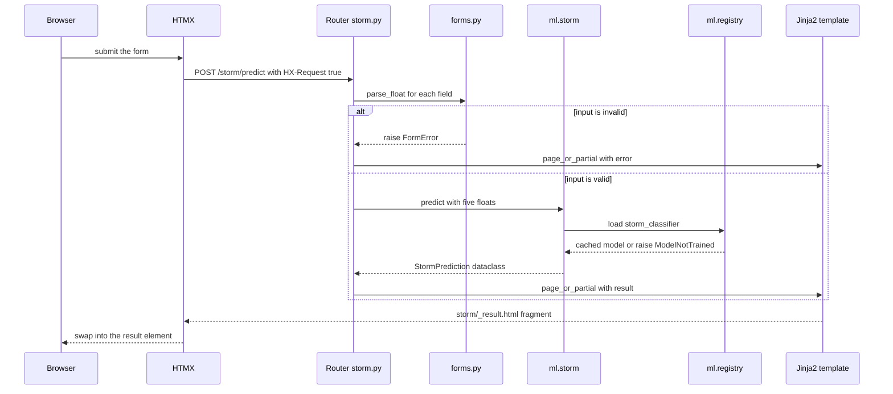
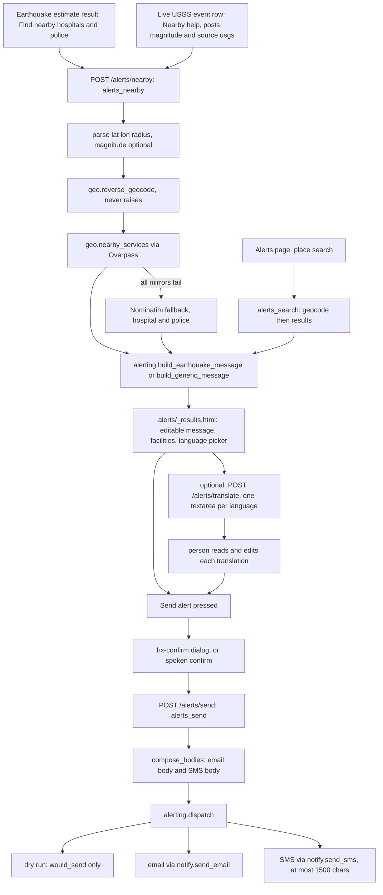
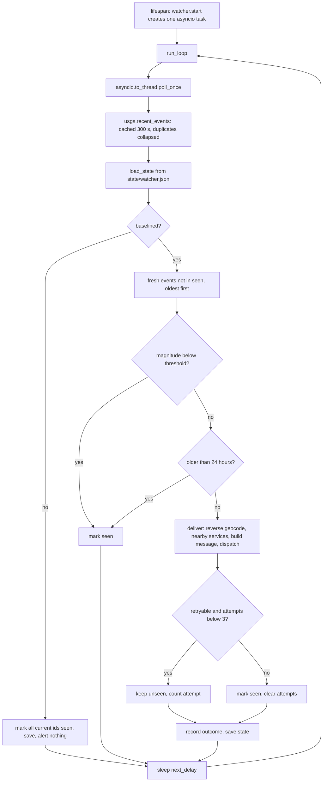
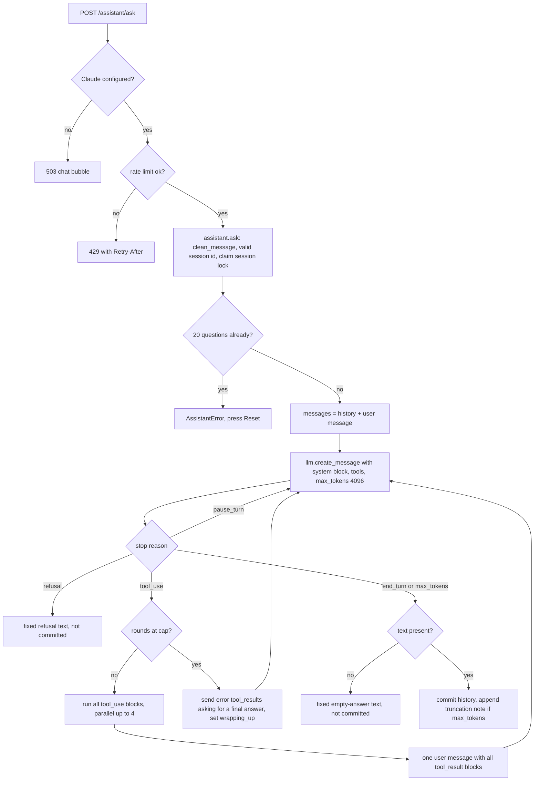

# Code walkthrough

This is the detailed companion to [architecture.md](architecture.md). It explains how the backend
works end to end, how to change it safely and how to add a feature. It covers everything under
`src/ndp/` except the internals of `ml/` (see [models.md](models.md)) and the templates and static
files (see [frontend.md](frontend.md)). Deployment pieces and the test suite are covered here in
code terms; [deployment.md](deployment.md) has the operator's view and [data.md](data.md) the
datasets.

Every statement below can be checked in the source. Files are linked and functions are named.
Numbers about size, speed and coverage come only from [statistics.md](statistics.md) (generated by `uv run ndp-report`) and from
one coverage measurement, quoted in the Testing section.

## 1. How to read this repo in 15 minutes

Read in this order. The times add up to about fifteen minutes.

| Min | File | What to take from it |
|---:|---|---|
| 2 | [README.md](../README.md), [architecture.md](architecture.md) | The product, the layers, the endpoint list. |
| 3 | [main.py](../src/ndp/main.py), [config.py](../src/ndp/config.py), [web.py](../src/ndp/web.py), [forms.py](../src/ndp/forms.py) | App factory, settings, the HTMX partial rule, the input-error type. These four files are about 300 lines together. |
| 4 | [routers/storm.py](../src/ndp/routers/storm.py), `templates/storm/` ([page.html](../src/ndp/templates/storm/page.html), [_result.html](../src/ndp/templates/storm/_result.html)), [ml/storm.py](../src/ndp/ml/storm.py), [ml/registry.py](../src/ndp/ml/registry.py) | The smallest complete vertical slice: form, parse, predict, render. Every hazard page repeats it. |
| 2 | [routers/alerts.py](../src/ndp/routers/alerts.py), [services/alerting.py](../src/ndp/services/alerting.py), [services/geo.py](../src/ndp/services/geo.py) | How a message is composed and sent. `dispatch` is the only code that sends one. |
| 2 | [services/watcher.py](../src/ndp/services/watcher.py), [services/llm.py](../src/ndp/services/llm.py) | The one background task, and the one door to the Anthropic API. |
| 2 | [services/assistant.py](../src/ndp/services/assistant.py) | Skim the module docstring, `_build_tools`, `run_tool` and `ask`. The rest is tool bodies and rendering helpers. |

Then read two tests to see how the code is exercised: [tests/conftest.py](../tests/conftest.py) and
[tests/web/test_alert_chain.py](../tests/web/test_alert_chain.py).

## 2. Process and lifecycle

Everything starts in [main.py](../src/ndp/main.py).

**App factory.** `create_app()` builds a `FastAPI` instance with the title, the version from
[`ndp.__version__`](../src/ndp/__init__.py) and `debug=settings.debug`. It mounts `/static` from
`src/ndp/static`, includes the routers, adds the middleware and the exception handler, and registers
`GET /healthz`. The module ends with `app = create_app()`, so importing `ndp.main` builds one app
(this is the `ndp.main:app` target used by uvicorn). Tests call `create_app()` again to get a fresh
app after changing environment variables, because `create_app` reads settings when it runs
(`enable_covid`, `debug`).

Routers are included in a fixed order: `pages`, `earthquake`, `tsunami`, `flood`, `hurricane`,
`storm`, `weather`, `alerts`, `sentiment`, `live`, `assistant`, `api`. The `covid` router is included
only when `settings.enable_covid` is true. The order matters in one place: in
[routers/sentiment.py](../src/ndp/routers/sentiment.py) the fixed paths `/sentiment/score` and
`/sentiment/triage` are declared before the catch-all `/sentiment/{slug}`.

**Logging.** `_configure_logging()` attaches one `StreamHandler` to the logger named `ndp`, with the
format `LEVEL:     name: message`, sets level INFO and turns propagation off. Plain uvicorn leaves
application loggers silent, so without this nothing from `ndp.*` would print. Child loggers in use:
`ndp.llm`, `ndp.alerts`, `ndp.watcher`, `ndp.gdacs`, `ndp.assistant`, `ndp.triage`, `ndp.translate`.

**Security-headers middleware.** `security_headers` is an `@app.middleware("http")` function. After
the response is built it calls `response.headers.setdefault` for `X-Content-Type-Options: nosniff`,
`X-Frame-Options: SAMEORIGIN`, `Referrer-Policy: strict-origin-when-cross-origin` and a
`Permissions-Policy` that allows the microphone for this origin only and denies camera, geolocation
and payment. Because it uses `setdefault`, a route can override a header. It runs for every response,
including the 503 JSON from the exception handler.

**Lifespan.** `lifespan()` runs once per process:

1. `generated_dir.mkdir(parents=True, exist_ok=True)`, so training plots and static URLs have a home.
2. `_warm_up()`. For each key in `compare.HAZARDS`, if `registry.is_trained(compare.artifact_name(key))`
   it calls `registry.load`, which pulls the four comparison artifacts (two of them large, see the
   artifact sizes in [statistics.md](statistics.md)) into the registry's `lru_cache` before the first
   request. It then calls `sentiment.ensure_corpora()`, which downloads
   the NLTK resources that are missing; any exception is caught and logged as a warning, and the
   sentiment code retries lazily. Missing models are not an error here: pages report them. All other
   models (hazard, flood, tsunami, hurricane, storm, covid) are loaded on first use.
3. `await watcher.start(app)`, which does nothing unless `NDP_WATCH_QUAKES` is true.
4. On shutdown, `await watcher.stop(app)` cancels the task.

`_warm_up` is synchronous and uvicorn does not accept requests until startup finishes, so a cold
start with network access spends its first seconds on the NLTK check. `TestClient` only runs the
lifespan when it is used as a context manager (`with TestClient(create_app()) as client`). Only the
watcher tests do that ([tests/services/test_watcher.py](../tests/services/test_watcher.py)), so the
warm-up does not run in the rest of the suite.

**Registry cache.** [ml/registry.py](../src/ndp/ml/registry.py) wraps `joblib.load` in
`lru_cache(maxsize=32)`; `save()` clears the cache. `lru_cache` does not store exceptions, so an
artifact that appears after a `ModelNotTrained` is picked up on the next request. An artifact that was
already loaded is not reloaded when `ndp-train` rewrites it from another process: restart the server
after retraining. `registry.metadata()` is not cached and reads the JSON sidecar on every call.

**Exception handler for untrained models.** `ModelNotTrained` (defined in `ml/registry.py`, carries
`.name`) is handled globally. If the path starts with `/api/` the response is JSON
`{"detail": ..., "model": name}` with status 503. Otherwise it renders
[errors/not_trained.html](../src/ndp/templates/errors/not_trained.html), which tells the reader to run
`ndp-fetch-data` and `ndp-train`. See the note in section 4 about the status code of the HTML case.

**Serving.** `serve()` is the `ndp-serve` entry point. It calls
`uvicorn.run("ndp.main:app", host="0.0.0.0", port=8000, reload=settings.debug)`. Host and port are
fixed; `PORT` is not read here (only the Docker entrypoint reads it). Setting `NDP_DEBUG=true` turns on
auto-reload and FastAPI debug mode.

## 3. Configuration

[config.py](../src/ndp/config.py) defines one `Settings(BaseSettings)` class and
`get_settings()`, which is `lru_cache`d so the object is built once. Rules:

- Env prefix is `NDP_`: the field `alert_radius_km` is read from `NDP_ALERT_RADIUS_KM`. Matching is
  case-insensitive.
- A `.env` file is read with `env_file=".env"`, which is relative to the current working directory,
  not to the repository. Process environment variables win over `.env`. Unknown keys are ignored
  (`extra="ignore"`), so a stale `NDP_SOMETHING` never breaks startup.
- Every secret has an empty default. Features that need one report themselves as not configured and the
  app always starts. `Settings` exposes three derived booleans: `llm_configured`,
  `email_configured` (SMTP user, SMTP password and recipient all set) and `sms_configured` (Twilio SID,
  token, from number and recipient all set).
- The Anthropic key has a validation alias: `AliasChoices("NDP_ANTHROPIC_API_KEY", "ANTHROPIC_API_KEY")`.
  Both names work in the environment and in `.env`, and the `NDP_` one wins when both are set.
- Because of the cache, code that changes the environment (mostly tests) must call
  `get_settings.cache_clear()`. [tests/conftest.py](../tests/conftest.py) does this around its session
  fixture and many tests do it in a local `env` fixture.

| Setting | Environment variable | Default | Read by |
|---|---|---|---|
| `debug` | `NDP_DEBUG` | `False` | `main.create_app` (FastAPI debug), `main.serve` (reload) |
| `enable_covid` | `NDP_ENABLE_COVID` | `True` | `main.create_app` (mount router), `routers/pages.index` (module card), `templates/base.html` (nav), `ml/train.select` (include trainer) |
| `data_dir` | `NDP_DATA_DIR` | `<repo>/data/raw` | `ml/features.load_csv`, `data.fetch` and `data.missing`, `report.dataset_stats` |
| `models_dir` | `NDP_MODELS_DIR` | `<repo>/models` | `ml/registry` (artifact and sidecar paths, `all_metadata`), `report`, `ml/train.main`; also `deploy/entrypoint.sh` |
| `generated_dir` | `NDP_GENERATED_DIR` | `src/ndp/static/generated` | `main.lifespan` (mkdir), `ml/plots`, `routers/pages` and `routers/sentiment` (does the plot exist) |
| `openweather_api_key` | `NDP_OPENWEATHER_API_KEY` | empty | `services/weather.predict_city_weather`, `routers/weather`, `routers/pages.index` |
| `smtp_host` | `NDP_SMTP_HOST` | `smtp.gmail.com` | `services/notify.send_email` |
| `smtp_port` | `NDP_SMTP_PORT` | `465` | `services/notify.send_email` (`SMTP_SSL`) |
| `smtp_user` | `NDP_SMTP_USER` | empty | `notify.send_email` (login, and the From fallback), `email_configured` |
| `smtp_password` | `NDP_SMTP_PASSWORD` | empty | `notify.send_email`, `email_configured` |
| `alert_from_email` | `NDP_ALERT_FROM_EMAIL` | empty | `notify.send_email` (From, falls back to `smtp_user`) |
| `alert_to_email` | `NDP_ALERT_TO_EMAIL` | empty | `notify.send_email`, `alerting.dispatch` (dry-run text), `email_configured` |
| `anthropic_api_key` | `NDP_ANTHROPIC_API_KEY` or `ANTHROPIC_API_KEY` | empty | `services/llm.get_client`, `llm_configured` |
| `anthropic_model` | `NDP_ANTHROPIC_MODEL` | `claude-opus-5-5` | `services/llm.model_name`, `routers/assistant` (shown on the page) |
| `assistant_max_tool_rounds` | `NDP_ASSISTANT_MAX_TOOL_ROUNDS` | `6` | `services/assistant.ask` |
| `guidance_dir` | `NDP_GUIDANCE_DIR` | `<repo>/data/guidance` | `guidance.fetch_all`, `guidance.get_index` |
| `watch_quakes` | `NDP_WATCH_QUAKES` | `False` | `watcher.start`, `watcher.status`, `routers/alerts` (page badge) |
| `watch_min_magnitude` | `NDP_WATCH_MIN_MAGNITUDE` | `6.0` | `watcher.poll_once`, `watcher.status` |
| `watch_interval_seconds` | `NDP_WATCH_INTERVAL_SECONDS` | `300` | `watcher.run_loop`, `watcher.status` |
| `alerts_dry_run` | `NDP_ALERTS_DRY_RUN` | `False` | `alerting.dispatch`, `watcher.status`, `routers/alerts` |
| `alert_radius_km` | `NDP_ALERT_RADIUS_KM` | `15.0` | `routers/alerts.alerts_nearby` (default radius), `watcher._deliver`, `assistant._tool_draft_alert` |
| `alerts_passcode` | `NDP_ALERTS_PASSCODE` | empty | `routers/alerts.alerts_send` (required when set), the send form |
| `alerts_allow_custom_phone` | `NDP_ALERTS_ALLOW_CUSTOM_PHONE` | `False` | `routers/alerts.alerts_send` (otherwise the phone field is ignored) |
| `state_dir` | `NDP_STATE_DIR` | `<repo>/state` | `services/watcher.STATE_PATH` |
| `twilio_account_sid` | `NDP_TWILIO_ACCOUNT_SID` | empty | `notify.send_sms`, `alerting.dispatch`, `sms_configured` |
| `twilio_auth_token` | `NDP_TWILIO_AUTH_TOKEN` | empty | `notify.send_sms`, `alerting.dispatch`, `sms_configured` |
| `twilio_from_number` | `NDP_TWILIO_FROM_NUMBER` | empty | `notify.send_sms`, `sms_configured` |
| `alert_to_number` | `NDP_ALERT_TO_NUMBER` | empty | `notify.send_sms`, `alerting.dispatch` (dry-run text), `sms_configured` |

Two things that look like settings but are not:

- `PORT` and `FORWARDED_ALLOW_IPS` are read only by [deploy/entrypoint.sh](../deploy/entrypoint.sh)
  and passed to uvicorn.
- The watcher's state file path is a module constant, `watcher.STATE_PATH = <repo>/state/watcher.json`.
  It has no setting and is not on any Docker volume.

## 4. The request path of a prediction page

Take `POST /storm/predict`, the pattern every hazard page follows.



Step by step:

1. `GET /storm` renders `storm/page.html` with `_page_context()`: the registry metadata for the model
   card (`registry.metadata`), a `trained` flag (`registry.is_trained`), the plot list and the class
   names. The form carries both `method="post" action=...` and `hx-post`, so it works with and without
   JavaScript.
2. `POST /storm/predict` is a plain `def` handler, so FastAPI runs it in a thread pool. Form fields are
   declared as `str = Form("")` on purpose: FastAPI never produces a 422 for HTML forms. Parsing is
   done by [forms.py](../src/ndp/forms.py): `parse_float(value, label, lo, hi)`, `parse_date` (four
   accepted formats) and `parse_text(value, label, max_len)`. Each raises `FormError`, a `ValueError`
   subclass whose message is written for the reader (for example "Humidity (%) must be at most 100.").
3. The handler calls the ml module's `predict(...)`. It returns a frozen dataclass and loads its
   artifact with `registry.load(MODEL)`. Routers contain no model code.
4. The handler calls `web.page_or_partial(request, page, partial, page_context, **result)`:
   - If the request has the header `HX-Request: true` (`web.is_htmx`), it renders only the partial with
     the keyword arguments as context. HTMX swaps it into `#result`.
   - Otherwise it calls `page_context()` to rebuild the full page context, merges the result keywords
     into it and renders the full page. The result is on screen without JavaScript.
   - `web.render` always adds `settings` to the context.
5. The templates read `inputs` (to refill the form), `result` or `error`, and the context from step 1.

**Error model.**

| Condition | Raised in | Handled in | What the reader sees |
|---|---|---|---|
| Bad form input | `forms.py` (`FormError`) | the route's own `try/except`, in each router | The result partial with `error`; HTTP 200. Never a 422. |
| Model artifact missing | `registry.load` (`ModelNotTrained`) | global handler in `main.create_app` | Full-page request: the "not trained" page with status 503. HTMX request: an inline notice with status 200 (HTMX does not swap 5xx). `/api/` routes: JSON with status 503. |
| External service down or unconfigured | `services/*` (`ServiceError`) | the route's own `try/except` | A friendly message in the partial. Not a global handler. |
| Missing raw dataset | `ml/features.load_csv` (`DataMissing`) | `routers/covid.py`, `services/triage.sample_posts`, `ml/train.main` | A message, 503 for the COVID GeoJSON route, a skipped trainer for `ndp-train`. |
| Bad JSON body on `/api/v1/...` | Pydantic models in [routers/api.py](../src/ndp/routers/api.py) | FastAPI | 422 with field errors. The JSON API is the one place validation errors are 422. |

`ServiceError` handling is a per-route convention. A route that forgets to catch it returns a 500.
When you add a route that calls a service, catch `ServiceError` and render it as `error`.

**Status code of the not-trained response.** `web.render` takes a real `status_code`. The handler in
`main.create_app` branches on `is_htmx(request)`: a normal browser request gets
`errors/not_trained.html` with status 503; an HTMX request gets the small `errors/_not_trained.html`
partial with status 200, because HTMX 2 does not swap 4xx and 5xx responses by default and the notice
has to reach `#result`. The `/api/` branch returns JSON with status 503. Earlier versions passed
`status_code=503` into a `render` that ignored it, so every HTML response was 200; the tests in
[tests/web/test_web.py](../tests/web/test_web.py) (`test_untrained_model_*`) now pin all three
behaviours using an empty models folder. The assistant page installs its own `htmx:beforeSwap`
listener to show its 429 and 503 bubbles.

**Other routes that do not use `page_or_partial`.** Read-only fragments loaded on page open
(`GET /earthquake/events`, `GET /live/gdacs`, `GET /live/watcher`, `GET /covid/stats`) render a bare
partial with `render`. `POST /compare/{hazard}` is `async def` because it reads
`await request.form()` for a variable field list; an unknown hazard returns the page with an error and
status 200.

## 5. The service layer

[services/\_\_init\_\_.py](../src/ndp/services/__init__.py) defines `ServiceError(RuntimeError)`. Its
message is written to be shown to the user. Every module below converts transport failures
(`httpx.HTTPError`, bad JSON, missing keys) into it. Timeouts are per call; caches are in-process
(module globals, lost on restart, shared by all requests).

| Module | Wraps | Cache | Timeouts |
|---|---|---|---|
| `usgs` | USGS GeoJSON feed `4.5_week` | 300 s, one entry | 10 s |
| `geo` | Nominatim search and reverse, Overpass (3 mirrors) | none | 15 s, 10 s, 8 s per mirror |
| `gdacs` | GDACS event list | 600 s (60 s if Green failed) | 15 s |
| `openmeteo` | Open-Meteo forecast | 900 s per rounded location, 128 entries | 12 s |
| `covidstats` | disease.sh | 600 s per path | 10 s |
| `weather` | OpenWeatherMap | none | 15 s |
| `notify` | SMTP over SSL, Twilio | none | SMTP 20 s |
| `llm` | Anthropic Messages API | client cached, no response cache | 60 s, 2 SDK retries |

### usgs.py

[services/usgs.py](../src/ndp/services/usgs.py). `recent_events(limit=8) -> list[QuakeEvent]` returns the
strongest events of the past week (feed minimum magnitude 4.5), strongest first. `QuakeEvent` is a
frozen dataclass: `id`, `magnitude`, `place`, `lat`, `lon`, `depth_km`, `time` (UTC), `url`. The module
global `_cache` holds `(stored_at, events)` for `CACHE_SECONDS = 300`; the cache stores the whole
sorted list and `limit` slices it. The watcher and the assistant both pass a very large limit to get
all of it.

`collapse_duplicates(events)` merges listings of one earthquake from several networks: events within 90
seconds, 50 km and 0.5 magnitude of an already kept event are dropped, preferring ids that start with
`us` and then the larger magnitude. This is what stops the watcher alerting twice for one quake.

Failure: any `httpx.HTTPError`, `KeyError`, `ValueError` or `TypeError` becomes
`ServiceError("The USGS feed is unavailable right now (...)")`; a stale cache is not served on failure.
Tests: pure-function tests of `collapse_duplicates` in
[tests/services/test_usgs.py](../tests/services/test_usgs.py); everything else monkeypatches
`usgs.recent_events` (the network branch itself is not covered).

### geo.py

[services/geo.py](../src/ndp/services/geo.py). Free OpenStreetMap services; every request sends
`USER_AGENT` (`natural-disaster-prediction/<version> (...)`).

| Function | Returns | Failure behaviour |
|---|---|---|
| `geocode(query)` | `Place(name, lat, lon)`, best single match | `ServiceError` on HTTP error or no result |
| `reverse_geocode(lat, lon)` | `Place` | Never raises. On any HTTP or JSON error it returns a `Place` named `"lat, lon"` so an alert is never blocked on naming. |
| `nearby_services(lat, lon, radius_km, limit=40)` | `list[NearbyPlace]` (name, kind, lat, lon, address, phone), nearest first | Overpass failure falls back to Nominatim; `ServiceError` only if both fail |

`nearby_services` clamps the radius to 0.5 to 50 km and queries Overpass for `amenity` in `hospital`,
`police`, `doctors`, `clinic` (nodes and ways, `out center`). `_overpass` tries `OVERPASS_URLS` in
order with an 8 second timeout each and raises `ServiceError` if all fail. On that error
`_nominatim_fallback` asks Nominatim for "hospital" and "police" inside a bounding box
(`bounded=1`). It raises only if neither query answered; an empty list is a valid answer (an offshore
epicentre). Elements without a `name` are dropped. The kind labels are `Hospital`, `Police`, `Doctor`,
`Clinic` (`KINDS`).

Tests monkeypatch `geo.geocode`, `geo.reverse_geocode` and `geo.nearby_services` at the module
attribute, which works because callers use `geo.<name>(...)`. The HTTP code is the least covered
service file (30.9%, see section 11).

### gdacs.py

[services/gdacs.py](../src/ndp/services/gdacs.py). `recent_alerts(limit=30) -> list[GdacsEvent]` returns
the last `WINDOW_DAYS = 30` days of earthquakes, cyclones, floods, volcanoes, droughts and wildfires
(`EVENT_TYPES`), Red first, then Orange, then Green, newest first within a level. `GdacsEvent` is
frozen: `id` (`"<TYPE>-<eventid>"`), `kind`, `kind_name`, `name`, `alert_level`, `country`, `lat`,
`lon` (both may be `None`), `from_date`, `to_date`, `url` (only `https://` report links are kept),
`summary`. The alert level is GDACS's own assessment; the app only relays it.

Orange and Red are fetched separately from Green (up to 3 pages of 100 for Orange and Red, 1 page for
Green) so that many Green entries cannot push the rare important ones off page one. Orange and Red are
required: failure raises `ServiceError`. Green is best effort: if it fails, `_load` returns
`complete=False` and the cache lifetime drops to `PARTIAL_CACHE_SECONDS = 60` so a retry happens soon.
Parsing is defensive (`parse_event` returns `None` for unusable features, `representative_point`
handles points, lines, polygons and geometry collections), but a payload without a `features` list is
a `ValueError` and so a `ServiceError`.

Tests ([tests/services/test_live.py](../tests/services/test_live.py)) use recorded payloads from
`tests/fixtures/gdacs_*.json`, route `httpx.Client` through `httpx.MockTransport` (`patch_http`), and
clear the cache with `gdacs.clear_cache()`. The clock is injectable (`gdacs._clock`).

### openmeteo.py

[services/openmeteo.py](../src/ndp/services/openmeteo.py). `forecast(lat, lon, days=3, now=None) -> Forecast`
returns an hourly outlook from the current local hour, with `precip_24h_max_mm` (the largest rolling
24-hour sum), `precip_72h_total_mm`, `max_gust_kmh`, temperature extremes, `daily` summaries and
`advisories`. Coordinates outside range raise `ServiceError` without a request; `days` is clamped to
1 to 7. Open-Meteo returns HTTP 400 with a `reason` for bad requests, which is turned into a
`ServiceError`.

`assess(precip_24h_max_mm, max_gust_kmh, hours)` is a pure function that applies India Meteorological
Department 24-hour rainfall classes (`HEAVY_MM = 64.5`, `VERY_HEAVY_MM = 115.6`,
`EXTREMELY_HEAVY_MM = 204.5`) and a gale gust threshold (`GUST_KMH = 63.0`). The levels are `info`,
`watch` and `warning`, and every `Forecast` carries `DISCLAIMER`: the advisories are heuristics from
model data, not warnings. Cache: key `(round(lat, 2), round(lon, 2), days)`, 900 seconds, at most 128
entries (the oldest inserted is evicted). Tests inject `now` and clear with `openmeteo.clear_cache()`;
the fixture is `tests/fixtures/openmeteo_mumbai.json`.

### covidstats.py and weather.py

[services/covidstats.py](../src/ndp/services/covidstats.py): `world()` and `india()` return a frozen
`Totals` from disease.sh, cached per path for 600 seconds. Failures become `ServiceError`. Tests patch
`covidstats.world` and `covidstats.india`
([tests/web/test_covid.py](../tests/web/test_covid.py)).

[services/weather.py](../src/ndp/services/weather.py): `predict_city_weather(city, lat, lon) -> WeatherResult`
is the preserved 2020 demonstration. It fetches the ten nearest OpenWeatherMap stations, fits a
`KNeighborsClassifier` on them in the request, and compares its prediction with the city's reported
weather. This is the one place a model is fitted inside a request; it is a tiny in-memory fit on ten
rows, nothing is saved. Without `NDP_OPENWEATHER_API_KEY` it raises `ServiceError`. No test calls it
directly (coverage 42.0%), and `routers/weather.py` imports it by name, so a test must patch
`ndp.routers.weather.predict_city_weather`.

### notify.py and alerting.py

[services/notify.py](../src/ndp/services/notify.py) is the only code that talks to SMTP or Twilio.
`send_email(subject, body) -> str` uses `smtplib.SMTP_SSL` with a 20 second timeout and
`send_sms(body, to_number=None) -> str` imports Twilio lazily (the `alerts` extra) and raises
`ServiceError("Twilio is not installed; ...")` if it is absent. Both return a short description such as
`"email to <address>"` and convert failures into `ServiceError`. `alerting.py` is described in section
6. Tests never exercise `notify` itself; they monkeypatch `notify.send_email` and `notify.send_sms`
(or `alerting.notify.send_email`).

### guidance.py

[guidance.py](../src/ndp/guidance.py) is not under `services/` but is used like one. It holds the
fetcher (`ndp-fetch-guidance`: `SOURCES`, `fetch_source`, `fetch_all`, an HTML-to-Markdown
`_Extractor`) and the search used by the assistant. Pages are committed under `data/guidance/*.md`
with front matter (`title`, `source_url`, `hazard`, `retrieved`, `license_note`), so the app works
offline. `search(query, hazard=None, k=4)` builds a TF-IDF index once per directory (`get_index`, a
locked dict), over chunks of about `CHUNK_CHARS = 800` characters, with a small stemmer and bigrams.
A hazard filter returns that hazard plus `general` pages, and at most `MAX_PER_SOURCE = 2` chunks per
page come back. A failed fetch keeps the committed file. Tests: [tests/services/test_guidance.py](../tests/services/test_guidance.py)
(including checks on the committed corpus).

### llm.py

[services/llm.py](../src/ndp/services/llm.py) is the only module that imports the Anthropic SDK (a search of `src/ndp`
for `import anthropic` finds only this file). The assistant, triage and translation all call it.

| Item | Behaviour |
|---|---|
| Client | `get_client()` raises `LLMNotConfigured` (a `ServiceError`) without a key, else returns `_client(key)`: one `anthropic.Anthropic` per key (`lru_cache(maxsize=4)`), `timeout=60.0`, `max_retries=2`. |
| Model | `model_name()` returns `settings.anthropic_model`, default `claude-opus-5-5`. A caller may pass `model=` to `create_message` to override it. [render.yaml](../render.yaml) sets `claude-sonnet-5-5` for the public deployment. |
| Refusal fallbacks | `create_message(**kwargs)` calls `client.beta.messages.create(model=..., betas=[FALLBACK_BETA], fallbacks="default", ...)` when the model is in `FALLBACK_MODELS` = `claude-opus-5-5`, `claude-opus-5`, `claude-fable-5-1`, `claude-sonnet-5-5`. For any other model (the code comment names Haiku 5.5) it calls plain `client.messages.create` without the parameter, because those models reject it. `FALLBACK_BETA` is `server-side-fallback-2026-07-01`. |
| Structured output | `parse(schema, system, user, max_tokens=2000)` uses `client.messages.parse(..., output_format=schema)` with the plain (non-beta) endpoint and no fallbacks. It raises `ServiceError` if the response is a refusal or `parsed_output` is `None`. |
| Refusals | A refusal is a normal HTTP 200 with `stop_reason == "refusal"`. `refused(response)` tests for it; each caller decides what to say. |
| Text | `text_of(response)` joins the `text` blocks and skips thinking and tool blocks. |
| Error mapping | `friendly_errors()` is a context manager used by `create_message` and `parse`. A `ServiceError` passes through. `AuthenticationError` becomes "key was rejected" (logged at error level). `PermissionDeniedError`, `NotFoundError` (mentions `NDP_ANTHROPIC_MODEL`), `RateLimitError`, `APITimeoutError`, `APIConnectionError` each get a fixed sentence. Other `APIStatusError`: 5xx becomes "temporarily unavailable", anything else "rejected the request (status)". No raw exception text reaches the UI. |
| Usage counters | `_record_usage(response)` adds to the module dict `_usage` under a lock: `requests`, `input_tokens`, `output_tokens`, `cache_read_input_tokens`, `cache_creation_input_tokens`. `usage_totals()` returns a copy. They are process-wide and in memory. `evals/triage.py` reports the difference before and after a run; the assistant also keeps a per-turn `Usage` object (section 7). |

Why no `temperature`, `top_p`, `top_k`, assistant prefill or forced `tool_choice`: the module docstring
records that current models reject the sampling parameters and that forced `tool_choice` is rejected
by Opus 5.5, so behaviour is steered by the prompt instead.
[tests/services/test_llm.py](../tests/services/test_llm.py)
(`test_default_model_uses_refusal_fallbacks_and_no_sampling_params`) asserts that none of those
arguments is ever passed and that fallbacks are requested for the default model and omitted for
`claude-haiku-5-5`.

How tests fake it, at three levels: replace `llm.get_client` with a fake client object
(`test_llm.py`); replace `llm.create_message` with a scripted function (assistant and translation
tests; this works because callers write `llm.create_message(...)`); replace `llm.parse` (triage tests).
No test needs a key. Callers that check configuration use `llm.is_configured()`, which tests patch.

### triage.py and translate.py

These are the two other Claude features. Both treat user text as data: it is wrapped in delimiters
(`<post>`, `<message>`), the system prompt says everything inside is data, any closing tag inside the
text is defanged, and the text is capped.

[services/triage.py](../src/ndp/services/triage.py). `triage_post(text) -> Triage` calls
`llm.parse(Triage, SYSTEM_PROMPT, build_user_prompt(post), max_tokens=600)`. `Triage` is a Pydantic
model: `needs` (a list drawn from nine `Need` values), `urgency` (`low`, `medium`, `high`, `critical`),
`summary` (at most 200 characters), `location_mentioned`, `language`, `confidence`. Validators dedupe
needs, cap the summary and blank placeholder locations. `MAX_POST_CHARS = 1500`. For Latin-script posts a
named location that does not appear in the text is dropped (`_location_is_grounded`), so the model
cannot invent a place. Post text is never logged at info level, only lengths. `triage_sample(slug, n)`
triages up to `MAX_SAMPLE = 5` random posts from a disaster dataset, one call per post, returning
`Triage` or `TriageFailure` per row; only `LLMNotConfigured` aborts the whole call.

[services/translate.py](../src/ndp/services/translate.py). `translate_many(message, languages) ->
dict[str, Translation]` makes one `llm.create_message` call per language in a thread pool
(`MAX_WORKERS = 4`) so one failure affects only that language. Languages are the twelve in
`LANGUAGES`. Every result passes `validate_translation(source, translated, code)` before it can reach
the review form: non-empty, not just the English echoed back, the right script (at least 20% of
letters, for non-Latin languages), the same number of non-empty lines, and exactly the same digit runs
as the source, so a changed phone number or magnitude is rejected. Successful text ends with
`MT_NOTE`. `MAX_MESSAGE_CHARS = 1200`. Only `LLMNotConfigured` propagates out. `translate_alert` is a
convenience that returns only the validated texts.

Tests: [tests/services/test_triage.py](../tests/services/test_triage.py) and
[tests/services/test_translate.py](../tests/services/test_translate.py) fake `llm.parse` and
`llm.create_message` respectively and cover prompt wrapping, validation and per-item isolation.

### watcher.py and assistant.py

Sections 6 and 7.

## 6. The alert chain and the watcher

Nothing is sent unless a person presses a button in a browser or the operator turns the watcher on.



**Entry points.** The estimate result's button posts only `lat`, `lon` and `radius_km`, so the message
is the generic "Emergency alert for ..." text. A row in the live events list posts `lat`, `lon`,
`depth`, `date`, `magnitude` and `source=usgs` ([earthquake/_events.html](../src/ndp/templates/earthquake/_events.html)).
`alerts_nearby` then builds `build_earthquake_message(..., reported=(source == "usgs"))`. The
`reported` flag selects the wording: "USGS-reported magnitude" with `REPORTED_NOTE`, versus
"estimated magnitude" with `DISCLAIMER`. Both end with a sentence saying the message is automated and
not an official warning. The alerts page itself also offers a place search (`POST /alerts/search`,
which geocodes the name first).

**Composition.** [services/alerting.py](../src/ndp/services/alerting.py):
`build_earthquake_message(place_name, lat, lon, magnitude, depth_km, on, places, reported=False)` and
`build_generic_message(place_name, lat, lon, places)`. `_facility_lines` lists up to three hospitals
(with phone numbers when mapped) and two police stations from the places found. The router
looks up facilities once (`_results_response`); if that lookup fails the form is still shown with a
warning, so an alert can be written without a list.

**Translation preview.** `POST /alerts/translate` (`alerts_translate`) is HTMX only. Without a Claude
key it renders a note. Otherwise it validates the languages against `translate.LANGUAGES`, calls
`translate.translate_many`, and returns an `alerts/_translations.html` partial that is swapped inside
the send form: one editable textarea per language named `translation_<code>`. The person edits and
approves them, and the text that is sent is whatever is in the textareas when Send is pressed. A
language that failed validation appears as an error instead of a textarea.

**Confirm and abuse limits.** The human confirmation is made in the browser: the send form has
`hx-confirm="Send this alert to the configured contacts?"`, and the submit button carries
`data-voice-command="send alert"` with `data-voice-confirm`, which requires a spoken "confirm" (see
[frontend.md](frontend.md); after a spoken confirm the native dialog is skipped through an
`htmx:confirm` handler, so a voice user answers once). A browser dialog is not a security control,
so `POST /alerts/send` also enforces, on the server:

- a per-client rate limit (`SEND_LIMIT = 5` sends per `SEND_WINDOW_SECONDS = 600`, using
  [services/ratelimit.py](../src/ndp/services/ratelimit.py)); the sixth attempt gets "Too many alerts
  from this address" and never reaches the dispatcher;
- an optional shared passcode (`NDP_ALERTS_PASSCODE`); when set, the form shows a password field and a
  missing or wrong value is refused (compared with `secrets.compare_digest`);
- no arbitrary SMS recipient: the `phone` field is ignored, and reported as ignored, unless
  `NDP_ALERTS_ALLOW_CUSTOM_PHONE=true`, in which case it must look like a phone number.

These are covered in [tests/web/test_alert_send_security.py](../tests/web/test_alert_send_security.py).
There is still no user authentication: anyone who can open the site can press Send, up to the limit,
so a public deployment should keep dry run on or set the passcode. This is covered again in sections 13
and 14.

**Send and dispatch.** `alerts_send` validates place (at most 300 characters), message (1200) and each
translation (4000), then calls `compose_bodies(text, translations)`:

| Case | Email body | SMS body |
|---|---|---|
| No translations | the message | the message |
| Translations, total at most `SMS_LIMIT = 1500` | English, then `=== <Language> ===` sections | same text |
| Translations, total over 1500 | same | English text trimmed to leave room for `[Translations are in the email version.]` |

`_dispatch` then calls `alerting.dispatch(place_name, body, phone, sms_body=...)`.
`dispatch` returns a `DispatchResult(channels, skipped, would_send, dry_run)`:

- Email: if `email_configured`, then in dry run it records `would_send` ("email to <address>"), else it
  calls `notify.send_email("Disaster alert: <place>", body)` and records the channel or the
  `ServiceError` text under `skipped`. If not configured it records "email not configured".
- SMS: ready if `sms_configured`, or if a phone number was passed and the Twilio SID and token are set.
  The router only passes a number when `NDP_ALERTS_ALLOW_CUSTOM_PHONE` is on. It sends
  `(sms_body or body)[:1500]`; Twilio's failure comes back as a skipped entry.
- The outcome is logged at info level and rendered by `alerts/_sent.html`, which says "Dry run,
  nothing was sent", "Alert sent" or "Nothing was sent". It never claims a send that did not happen.

### The watcher

[services/watcher.py](../src/ndp/services/watcher.py) is the only automatic sender. It is opt-in
(`NDP_WATCH_QUAKES=true`) and uses the same `alerting` functions, so dry run, channel configuration and
the "not an official warning" wording all apply.



Rules, each visible in the code:

- **One task, blocking work off the loop.** `start(app)` creates `asyncio.create_task(run_loop())`
  and stores it in `app.state.watcher_task`. `run_loop` calls `poll_once` through
  `asyncio.to_thread`, so HTTP, SMTP and file writes never block the event loop. It polls immediately
  at start, then sleeps. Only `CancelledError` ends the loop; any other exception is logged, stored in
  `last_error`, and counted in `failures`.
- **Backoff.** `next_delay(interval, failures)` is `interval` after a good poll and
  `min(interval * 2 ** min(failures, 5), max(interval, 1800))` after failures. With the default 300
  seconds the delays are 300, 600, 1200, then 1800 (`MAX_BACKOFF_SECONDS`) and stay there.
- **Baseline.** If the state file is missing or unreadable (or says `baselined: false`), the
  first poll only records the ids already in the feed (the last `MAX_SEEN = 2000`) and alerts nothing,
  so enabling the watcher never sends a burst for the past week. Deleting the file while the server
  runs is the same as a fresh start, because `poll_once` re-reads the file on every poll.
- **Duplicate events.** The watcher asks `usgs.recent_events(FEED_LIMIT)` for the whole feed. The same
  quake listed by two networks has already been collapsed by `usgs.collapse_duplicates`. Beyond that,
  an id in `state.seen` is never alerted again.
- **Order, threshold and age.** New events are processed oldest first. Below
  `watch_min_magnitude` (inclusive threshold) or older than `MAX_ALERT_AGE = 24 hours`, an event is
  marked seen without an alert. So a restart alerts for quakes missed while the app was down, but only
  for the last day.
- **Delivery.** `_deliver(event)` reverse-geocodes (falls back to the USGS place string), looks up
  facilities within `alert_radius_km` (falls back to none), builds the message with `reported=True`,
  appends the USGS event page URL, and calls `alerting.dispatch(place_name, body)`. The outcome string
  is "dry run, would send: ...", "sent: ..." or "not sent: ...".
- **Retry rules.** `_deliver` returns `(outcome, retryable)`. Dry run and success are final. If nothing
  was sent, the result is retryable only when at least one skipped reason is not "not configured",
  that is, a configured channel actually failed. If `_deliver` raises, the outcome is "failed: ..." and
  it is retryable. A retryable event stays out of `seen` and its attempt count is stored;
  `MAX_ATTEMPTS = 3` attempts are made, then it is marked seen. The 24-hour age cap bounds retries too.
- **State file.** `save_state` writes a temp file in the same directory, `fsync`s and `os.replace`s
  it. State holds `seen` (bounded), `attempts`, `handled` (the newest `MAX_HANDLED = 20` outcomes,
  shown on the Live page) and `baselined`. State is saved after each event, before moving on, so a
  crash cannot cause a second alert for the same event.
- **Status.** `status()` returns a `WatcherStatus` used by the Live page and `GET /live/watcher`
  (the alerts page only shows whether `watch_quakes` is on). When the task has not started in this
  process it reads `handled` from the file.

Tests ([tests/services/test_watcher.py](../tests/services/test_watcher.py)): `poll_once(fetch=,
deliver=, now=)` and `run_loop(poll=, interval=, sleep=)` take injected callables; the `state_file`
fixture monkeypatches `watcher.STATE_PATH` to a temp path and calls `watcher.reset()`.

## 7. The assistant

[services/assistant.py](../src/ndp/services/assistant.py) is a manual tool loop over nine tools,
sorted by name: `draft_alert`, `earthquake_hazard`, `flood_forecast`, `gdacs_alerts`, `geocode`,
`nearby_services`, `preparedness_guidance`, `recent_earthquakes`, `weather_forecast`. The router is
[routers/assistant.py](../src/ndp/routers/assistant.py).



**The loop** (`ask(session_id, message)`):

- Input is cleaned by `clean_message`: NFC normalisation, control, format (zero-width, bidi),
  surrogate and unassigned characters removed, blank lines collapsed, at most
  `MAX_MESSAGE_CHARS = 1500`. Empty or oversize input raises `AssistantError` (a `ServiceError`).
- Without a key it raises `LLMNotConfigured`. The session id must match `^[A-Za-z0-9_-]{22,64}$`.
- The session is claimed with a non-blocking lock (`_claimed`); a second request on the same session
  while one is running gets "I'm still working on your previous question."
- `max_rounds = max(0, settings.assistant_max_tool_rounds)` (default 6). The `for` loop runs at most
  `max_rounds + 4` times: the rounds, a wrap-up call, and a few continuations.
- Each iteration calls `llm.create_message(system=SYSTEM_BLOCKS, tools=TOOL_DEFINITIONS,
  messages=messages, max_tokens=MAX_TOKENS)` with `MAX_TOKENS = 4096`. No sampling parameters and no
  `tool_choice`.
- The assistant's `response.content` is appended to the history unchanged, so thinking blocks survive
  across rounds and turns. All `tool_result` blocks for one assistant turn go back in one user
  message, in the same order, and a failing tool becomes a result with `is_error: true`.
- Round cap: when the model still asks for tools after `max_rounds` rounds, every requested call gets
  an error result (`LIMIT_REACHED_TOOL_MESSAGE`) and `wrapping_up` is set. If it asks for tools again,
  the loop gives up with its last text or `GIVE_UP_TEXT`.
- Stop reasons: `refusal` returns `REFUSAL_TEXT` and is not committed; `pause_turn` simply re-sends;
  `end_turn` returns the text; `max_tokens` returns the text plus `TRUNCATED_NOTE` (and the turn is
  kept); `max_tokens` that cut a tool call off returns the text or `GIVE_UP_TEXT` without running the
  call and without committing. An empty answer returns `EMPTY_TEXT`. A turn is committed to the session
  (`session.messages` and `session.log`) only on a complete answer, so a half-finished tool exchange
  never poisons later turns. An API failure raises before anything is committed.
- `AssistantTurn` carries `answer`, `tools_used` (name and summary per call), `sources`, `refused`, and
  for the evals `rounds` and `usage` (a per-turn `Usage`: input, output, cache read and cache write
  tokens, and API calls).

**Prompt caching.** `SYSTEM_BLOCKS` is one text block, `SYSTEM_PROMPT`, with
`cache_control: {"type": "ephemeral"}`. The tool list renders before the system prompt in the request,
so this single breakpoint covers both. The tool order is fixed (sorted by name) and nothing volatile
(dates, session ids) is placed in the prefix. There is no breakpoint on the conversation messages.
`Usage.add` reads `cache_read_input_tokens` and `cache_creation_input_tokens` from each response.

**Tool results.** A `Tool` is a frozen dataclass: `name`, `description`, `properties`, `required`,
`run`. `definition()` produces `{"name", "description", "strict": True, "input_schema": {... ,
"additionalProperties": False}}`, with only plain JSON-schema keywords (a test restricts the allowed
keys). `run_tool(name, args)` never raises. It returns `(content, is_error, ToolCall, sources)`:

- Success: `content` is compact JSON of `ToolResult.data`, capped at `MAX_TOOL_RESULT_CHARS = 6000`
  (`_cap_json` replaces an oversize result with a valid JSON object marked `truncated`).
- Failure: `"Error: ..."` text with `is_error` true, for an unknown tool, non-object input, a
  `ToolInputError` (arguments outside the clamps checked by `_num`, `_clamped`, `_text`), a
  `ServiceError` (clipped to 300 characters), `ModelNotTrained`, or an unexpected exception (logged,
  with a generic message). Inputs are validated and clamped in code even though the schemas are
  strict, because the schema is a request to the model, not a guarantee.
- Each tool returns a `ToolResult(data, summary, sources)`. Results carry their own caveats: the
  hazard result includes `caveats` about aftershocks and noisy small counts, the flood result says
  not to report a flood verdict, and every source is a `Source(title, url)` that the router shows
  (merged and capped at `MAX_SOURCES = 8`).
- Several `tool_use` blocks in one turn run in a thread pool (`MAX_PARALLEL_TOOLS = 4`).

**Sessions and rate limiting.** `SessionStore` is an in-memory `OrderedDict` of `Session`
(`messages`, `log`, a lock) with least-recently-used eviction at `MAX_SESSIONS = 200`; each session
holds at most `MAX_USER_TURNS_PER_SESSION = 20` questions. There is no time-based expiry on the server;
the cookie lifetime is separate. Session ids come from `secrets.token_urlsafe(16)`. The router sets the
`ndp_assistant` cookie only on its own three endpoints, with `max_age` 6 hours, `path=/assistant`,
`HttpOnly`, `SameSite=Lax`, and `Secure` when the request scheme is https. `RateLimiter` is a
sliding window per client key (the request's client host): `RATE_LIMIT_MESSAGES = 10` per
`RATE_LIMIT_WINDOW_SECONDS = 60`, with at most 10,000 keys. Behind a proxy the client host is only
correct if uvicorn trusts the proxy headers, which is why the entrypoint passes `--proxy-headers` and
`--forwarded-allow-ips`. The router turns errors into chat bubbles: 503 for a missing key or
`ServiceError`, 429 with `Retry-After` for the limiter, 400 for `AssistantError`, and a generic 503 for
anything unexpected. HTMX gets the `_turn.html` partial; a plain POST gets the full page.

**Why no tool can send anything.** None of the nine tool functions touches `notify` or
`alerting.dispatch`. `draft_alert` only calls `alerting.build_earthquake_message` or
`build_generic_message` and returns `{"status": "DRAFT_NOT_SENT", "draft": ..., "next_step": ...}`; the
system prompt tells the model to say nothing was sent and to direct the person to the Alerts page. The
test that enforces this is `test_no_tool_and_no_module_code_can_send_anything` in
[tests/services/test_assistant.py](../tests/services/test_assistant.py): it greps the module source,
every tool's name, description and source, the names each tool function references, and the module's
namespace for `notify|dispatch|send_email|send_sms|smtplib|twilio|sendmail`. It also checks that the
description of `draft_alert` says "sends nothing" exactly once. The eval harness adds a second check on
the model's wording (section 8).

**Rendering helpers.** `safe_markdown` (registered as the Jinja filter `assistant_md`) escapes the
text first and then produces only a fixed set of tags (paragraphs, lists, bold, code, links with
`rel="noopener noreferrer nofollow"`), so model output cannot inject markup. `plain_text`
(`assistant_plain`) prepares the answer for speech.

## 8. Evals

`ndp-eval` is [evals/\_\_init\_\_.py](../src/ndp/evals/__init__.py) `main()`, an `argparse` program
with two sub-commands.

**`ndp-eval assistant`** (`--cases`, `--limit`, `--ids`, `--json`, `--check`):

1. `load_cases` reads `data/evals/assistant_cases.jsonl` (36 cases per [data.md](data.md)).
2. `validate_cases` checks the file itself: duplicate or missing ids, empty questions, tool names that
   are not in `assistant.TOOLS`, contradictory expectations and invalid regexes. A typo cannot silently
   weaken a case. Problems exit with status 2.
3. `--check` stops here and needs no key. Without a key the command prints
   `skipped: no ANTHROPIC_API_KEY` and exits 0, so it is safe in CI.
4. With a key, `run_assistant` asks each case in a fresh session through `assistant.ask` (real tools
   against live services, real model) and grades it with `grade_case`, a pure function.

Grading is deterministic code, not a model. Fields per case: `expect_tools_any`, `expect_no_tools`,
`forbid_tools`, `must_mention` (every regex must match), `must_not` (none may match) and
`expect_sources`. `GLOBAL_MUST_NOT` is added to every case and flags claims such as "I sent", "the
alert was sent", "I will send" and "I predict". `summarise` reports pass rate, tool-use rate,
must-mention and must-not rates, mean tool rounds, token totals and an estimated cost from the
`PRICES` table. The module docstring lists the limits: regexes see words not meaning, cases hit live
services and a non-deterministic model, and a small handwritten set is a smoke test, not a benchmark.
The `PRICES` table is a snapshot and has to be updated when prices or the default model change.

**`ndp-eval triage`** calls [evals/triage.py](../src/ndp/evals/triage.py) `run(limit)` over
`data/evals/triage_cases.jsonl` (22 cases). It reports agreement with the author's own labels:
`needs_overlap_rate`, `urgency_in_band_rate`, `under_triage_rate` (urgency below the lowest accepted
band, the dangerous direction) and `parse_failure_rate`, plus token totals from
`llm.usage_totals()`. It also prints and returns a caveat that this is not an accuracy benchmark.
Without a key it prints a skip message.

Tests: [tests/services/test_evals.py](../tests/services/test_evals.py) and part of
[tests/services/test_triage.py](../tests/services/test_triage.py) cover the case files, graders, cost
estimate and the no-key path with fakes.

## 9. Entry points and CLIs

Declared in `[project.scripts]` of [pyproject.toml](../pyproject.toml). All six exist in the
virtual environment's `bin/`.

| Command | Target | What it does | Needs |
|---|---|---|---|
| `ndp-serve` | `ndp.main:serve` | Runs uvicorn on `0.0.0.0:8000`, reload when `NDP_DEBUG` is true. | Optional: trained models for the model pages, keys for the optional features. |
| `ndp-fetch-data` | `ndp.data:main` | Downloads the CSVs in `data.DATASETS` into `NDP_DATA_DIR`, skipping files that exist. Flags `--force`, `--quiet`. Exit 1 on a download error. | Network. Files come from `raw.githubusercontent.com` at `PINNED_COMMIT = "26cdd7d"`. |
| `ndp-train` | `ndp.ml.train:main` | Trains the trainers in `TRAINERS` (`flood`, `catalogue`, `hazard`, `tsunami`, `hurricane`, `storm`, `compare`, `sentiment`, `covid`), saves artifacts and sidecars to `NDP_MODELS_DIR` and plots to `NDP_GENERATED_DIR`, prints a one-line headline per trainer, records timings (`training_run`). Positional names pick a subset; `--quick` shrinks `compare` and skips sentiment; `--skip-sentiment`; `--include-covid`. A trainer whose dataset is missing is reported as SKIPPED and the exit code is 1. | The raw datasets; NLTK corpora for `sentiment`. |
| `ndp-fetch-guidance` | `ndp.guidance:main` | Re-downloads the preparedness pages into `NDP_GUIDANCE_DIR`; `--dest` overrides. Exit 1 if any page fails; a failed page keeps its committed file. | Network. Not needed to run the app, the pages are committed. |
| `ndp-eval` | `ndp.evals:main` | `assistant` and `triage` eval suites (section 8). | A key for real runs; none for `--check`. |
| `ndp-report` | `ndp.report:main` | Builds a Markdown statistics report from the working tree, the datasets and the model sidecars; `--write PATH`, `--bench` (times endpoints in process). This is how [statistics.md](statistics.md) is produced. | Runs on a bare checkout and says what is missing. |

`uv run python -m ndp.guidance` also works. `python -m ndp.evals` does not, although the module
docstring shows it: `ndp.evals` is a package without a `__main__.py`, so use `ndp-eval`. There are no
other console scripts.

The ml side of the web layer is small. The routers use only: `registry` (`load`, `metadata`,
`is_trained`, `ModelNotTrained`), each model module's `MODEL` constant and `predict(...)` returning a
frozen dataclass, `compare.HAZARDS` and `compare.predict`, `sentiment.scores`/`score_text`/`DISASTERS`,
and `features.DataMissing`. `train()` in each module writes an artifact with `registry.save(name,
artifact, metadata)` and returns the metadata dict. See [models.md](models.md) for the models.

## 10. Deployment in code terms

[docs/deployment.md](deployment.md) is the operator's guide. The code facts are:

**Dockerfile** ([deploy/Dockerfile](../deploy/Dockerfile)). One stage, from
`ghcr.io/astral-sh/uv:python3.12-bookworm-slim`. It sets `UV_COMPILE_BYTECODE=1`, `UV_LINK_MODE=copy`,
`PYTHONUNBUFFERED=1`, then caches dependencies as their own layer: copy `pyproject.toml` and
`uv.lock`, `uv sync --frozen --no-dev --no-install-project --all-extras`. Then `COPY . .` and a second
`uv sync --frozen --no-dev --all-extras` installs the project. `--all-extras` pulls in Twilio. It
declares `VOLUME ["/app/data/raw", "/app/models"]`, exposes 8000 and sets
`ENTRYPOINT ["./deploy/entrypoint.sh"]`. [.dockerignore](../.dockerignore) excludes `.env`, `data/raw`,
`models`, `state` and `src/ndp/static/generated`, so none of those is baked into the image.

**Entrypoint** ([deploy/entrypoint.sh](../deploy/entrypoint.sh)). `set -eu`, then `cd /app`, then in
order:

1. `uv run --no-sync ndp-fetch-data --quiet`. It downloads only files that are missing, so a restart
   with all data present makes no request. A download error exits the container.
2. `uv run --no-sync ndp-train --if-missing`. `train.is_missing(name)` is true when a trainer's
   artifacts (`train.ARTIFACTS`) are not saved or its plots folder (`train.PLOT_DIRS`) is empty, so
   this is a no-op on a healthy volume, trains only a newly added model after a release, and redraws
   plots that were lost when the image was rebuilt.
3. `exec uv run --no-sync uvicorn ndp.main:app --host 0.0.0.0 --port "${PORT:-8000}"
   --proxy-headers --forwarded-allow-ips "${FORWARDED_ALLOW_IPS:-127.0.0.1}" "$@"`. Extra container
   arguments are appended to the uvicorn command. `exec` replaces the shell with `uv run`, which
   launches uvicorn.

**Compose** ([deploy/docker-compose.yml](../deploy/docker-compose.yml)). One service `web`, build
context `..`, port 8000, optional `../.env` (`required: false`), two named volumes `ndp-data` at
`/app/data/raw` and `ndp-models` at `/app/models`, and a health check that fetches `/healthz` with
`python3` every 30 seconds. The generated plots directory and the watcher state directory are not
volumes in the compose file; set `NDP_GENERATED_DIR` and `NDP_STATE_DIR` to mounted paths if you want
them to persist.

**Render blueprint** ([render.yaml](../render.yaml)). One `web` service with `runtime: docker`,
`dockerfilePath: ./deploy/Dockerfile`, `dockerContext: .`, `plan: starter`,
`healthCheckPath: /healthz`, and a 2 GB disk named `ndp-data` mounted at `/var/data`. Environment:
`NDP_DATA_DIR=/var/data/raw`, `NDP_MODELS_DIR=/var/data/models`, `NDP_GENERATED_DIR=/var/data/plots`
and `NDP_STATE_DIR=/var/data/state` (so all four land on the disk; `main.create_app` serves
`/static/generated` from the configured plots folder),
`FORWARDED_ALLOW_IPS=*` (trust Render's proxy so rate limiting sees client addresses),
`NDP_ENABLE_COVID=true`, `NDP_ANTHROPIC_MODEL=claude-sonnet-5-5`, `NDP_ALERTS_DRY_RUN=true`,
`NDP_WATCH_QUAKES=false`. Secrets (`ANTHROPIC_API_KEY`, `NDP_OPENWEATHER_API_KEY`, `NDP_SMTP_USER`,
`NDP_SMTP_PASSWORD`, `NDP_ALERT_TO_EMAIL`) are `sync: false`, set in the dashboard. Twilio variables
are not declared in the blueprint.

**CI** ([.github/workflows/ci.yml](../.github/workflows/ci.yml)). Runs on pushes to `master` and
`modernize` and on every pull request: `actions/checkout@v4`, `astral-sh/setup-uv@v5` with caching,
`uv python install 3.12`, `uv sync --all-extras`, `uv run ruff check .`, `uv run ndp-fetch-data --quiet`,
`uv run pytest -q`. Ruff
settings are in `[tool.ruff]` in [pyproject.toml](../pyproject.toml): line length 100, rules
`E F I UP B`, with `E501` ignored for `report.py`. The workflow does not run the Tailwind build, so a stale
`tailwind.css` would not be caught.

## 11. Testing

**Layout.**

| Path | Contents |
|---|---|
| [tests/conftest.py](../tests/conftest.py) | One session-scoped autouse fixture. It points `NDP_MODELS_DIR` and `NDP_GENERATED_DIR` at a temp directory and clears the settings cache, before and after. Models and plots written by tests never touch `models/` or `static/generated`. It does not redirect `NDP_DATA_DIR`. |
| [tests/factories.py](../tests/factories.py) | `make_hazard`, `quiet_hazard`, `make_forecast`: builders that return the real result dataclasses (`hazard.HazardEstimate`, `flood.FloodForecast`) so web tests need no trained model. |
| `tests/ml/` | Model maths, training on small or synthetic data, the registry, the `ndp-train` CLI (`test_train_cli.py` with fake trainers), the data manifest, `ndp-report`. |
| `tests/services/` | Every service module, plus the assistant, watcher, evals, triage and translation, mostly with fakes. Some also drive the routers. |
| `tests/web/` | Page smoke tests, form flows, the alert chain, alert translation, COVID, model cards, the JSON API. |
| `tests/js/` | `voice.test.mjs` run by `test_voice_js.py` with `node --test`; skipped if `node` is missing. |
| `tests/fixtures/` | Trimmed real responses: `gdacs_green.json`, `gdacs_orange_red.json`, `openmeteo_mumbai.json`. |

[statistics.md](statistics.md) counts 322 Python test functions and 18 JavaScript ones in its last
run; parametrised cases make `pytest` report more.

**Conventions.**

- No network, no trained models and no API key are needed. HTTP is replaced by monkeypatching the
  service function a router calls, or by routing `httpx.Client` through `httpx.MockTransport`
  (`patch_http` in `test_live.py`). Clocks and `now` are injectable.
- Patch at the attribute callers use. Routers call `geo.nearby_services(...)` and
  `llm.create_message(...)` through the module, so `monkeypatch.setattr(geo, "nearby_services", ...)`
  works. A router that does `from ... import name` (only `routers/weather.py` does this) needs the patch
  on the router's own name: `ndp.routers.weather.predict_city_weather`.
- Settings: change the environment with `monkeypatch.setenv`, then `get_settings.cache_clear()`, then
  build the app. Several files define a small `env` fixture that does this and clears again afterwards.
- Assistant and watcher tests inject their own fixtures (`FakeModel`, `stub_tool`, `state_file`); they
  reset module state (`assistant.sessions.clear()`, `watcher.reset()`) around every test.
- Three tests train on the real datasets: `test_storm_train_and_predict` and
  `test_flood_train_and_predict` in `tests/ml/test_ml_fast.py`, and `test_hazard_real_catalogue` in
  `tests/ml/test_ml_phase2.py`. They carry `@requires_data(...)` from
  [tests/factories.py](../tests/factories.py), so with an empty `NDP_DATA_DIR` they are skipped, and CI
  runs `ndp-fetch-data` first so they do run there.
- Settings and the per-client rate limiters are reset around every test by autouse fixtures in
  [tests/conftest.py](../tests/conftest.py). Tests that need an untrained model use an `empty_models`
  fixture, because other tests train into the shared temporary models folder.

**Running subsets.**

```bash
uv run pytest -q                                   # everything
uv run pytest tests/web -q                         # one layer
uv run pytest tests/services/test_watcher.py -q    # one file
uv run pytest -q -k "alert and not translate"      # by name
uv run pytest tests/services/test_assistant.py::test_round_cap_gives_a_graceful_answer
uv run ruff check .                                # what CI also runs
uv run --with pytest-cov pytest --cov=ndp          # coverage
```

**Coverage snapshot.** Measured with `uv run --with pytest-cov pytest --cov=ndp` on this commit, with
411 tests passing: total 84.2% (4,129 of 4,906 statements). By package: core modules 81.1%, evals
97.3%, ml 74.2%, routers 91.2%, services 88.1%. The weakest files:

| File | Coverage | Why |
|---|---:|---|
| `services/geo.py` | 30.9% | The network paths (Nominatim, Overpass, fallback) are always replaced by monkeypatching `geo.*`. |
| `ml/tsunami.py` | 33.3% | Training and prediction are barely exercised; web tests patch `predict`. |
| `data.py` | 35.1% | The download loop is not run in tests; only the manifest is checked. |
| `ml/catalogue.py` | 41.9% | Only a statistics helper is tested on a tiny frame. |
| `services/weather.py` | 42.0% | No test calls `predict_city_weather`; the router is tested only for validation. |
| `ml/train.py` | was 0% | It now has CLI tests (`tests/ml/test_train_cli.py`); this file was the 0% entry in the earlier measurement. |

Also uncovered by any test, from reading the code: the SMTP and Twilio calls in `services/notify.py`
(always monkeypatched) and the `source=usgs` branch of `alerts_nearby` through the route (the test
that posts a live event omits `source`).

**Writing a test for a new route.** Use the pattern in
[tests/web/test_phase2_web.py](../tests/web/test_phase2_web.py): a client fixture, a fixture that patches
the router's `predict` to return a factory object, then assertions on the HTML.

```python
import pytest
from fastapi.testclient import TestClient

from ndp.main import create_app
from ndp.routers import landslide as landslide_router
from tests.factories import make_landslide  # add this builder to tests/factories.py

HX = {"HX-Request": "true"}
FORM = {"rainfall_mm": "120", "slope_deg": "30"}


@pytest.fixture
def client():
    return TestClient(create_app())


@pytest.fixture
def ls(monkeypatch):
    calls = []

    def fake(*args):
        calls.append(args)
        return make_landslide()

    monkeypatch.setattr(landslide_router.landslide, "predict", fake)
    return calls


def test_valid_post_returns_the_partial(client, ls):
    resp = client.post("/landslide/predict", data=FORM, headers=HX)
    assert resp.status_code == 200 and "<html" not in resp.text  # partial only
    assert ls == [(120.0, 30.0)]


def test_post_without_htmx_returns_the_full_page(client, ls):
    assert "<html" in client.post("/landslide/predict", data=FORM).text


def test_invalid_input_is_inline(client, ls):
    resp = client.post("/landslide/predict", data={**FORM, "slope_deg": "999"}, headers=HX)
    assert resp.status_code == 200 and "at most" in resp.text and ls == []
```

Add a builder to `tests/factories.py` that returns the real dataclass, add the page path to the `PAGES`
list in `tests/web/test_web.py`, and add a test that the JSON route returns 422 for a bad body. The
page-smoke and untrained cases need no patch because the temp models directory is empty.

## 12. Worked example: add a new hazard

Suppose you add "landslide": a model that takes two readings and returns a class, with a page and a
JSON route. Nothing named landslide exists; the file names are illustrative. Copy
the storm slice for a classifier ([ml/storm.py](../src/ndp/ml/storm.py),
[routers/storm.py](../src/ndp/routers/storm.py), `templates/storm/`) or the tsunami slice for a
regressor ([ml/tsunami.py](../src/ndp/ml/tsunami.py), [routers/tsunami.py](../src/ndp/routers/tsunami.py)).
Do the steps in this order; each leaves the test suite passing.

1. **Data.** Add a `Dataset(filename, used_by, source)` to `data.DATASETS`
   ([data.py](../src/ndp/data.py)). `fetch` builds the URL as `RAW_BASE + filename`, and `RAW_BASE` is
   pinned to one commit of the legacy repository, so a CSV that is not in that commit needs a new
   download rule. [tests/ml/test_data_manifest.py](../tests/ml/test_data_manifest.py) checks the
   manifest has no duplicates and a source and consumer for each file.
2. **ML module** `src/ndp/ml/landslide.py`. Define `MODEL = "landslide_class"` (this is the registry
   name: `models/landslide_class.joblib` plus `.json`), `FEATURES`, a frozen result dataclass,
   `train() -> dict` and `predict(...)`. Pattern: `storm.train` loads with `features.load_csv`, splits,
   records an honest baseline and skill (`features.honest_metadata` for regressors), saves plots with
   `plots.save_current("landslide", "l1.png")`, sets `model.n_jobs = 1` for single-row prediction, and ends with
   `registry.save(MODEL, model, metadata)` and `return metadata`. `predict` calls `registry.load(MODEL)`
   and builds the row with `features.single_row`. Never train or download in `predict`.
3. **Trainer registration.** Import the module in [ml/train.py](../src/ndp/ml/train.py) and add
   `"landslide": landslide.train` to `TRAINERS`. The CLI choices come from that dict, so
   `uv run ndp-train landslide` works. Add a branch in `_headline` if the result shape is new.
4. **Router** `src/ndp/routers/landslide.py`, copied from `routers/storm.py`: `APIRouter(prefix="/landslide")`,
   `PLOTS`, `_page_context()` (metadata, `trained`, plots), `GET ""` named `landslide_page`, and
   `POST /predict` named `landslide_predict` that parses with `forms.parse_float`, catches `FormError`,
   calls `landslide.predict` and returns `page_or_partial`. Use `Form("")` string fields. Register it in
   [main.py](../src/ndp/main.py) twice: in the `from ndp.routers import (...)` list and in the tuple that
   is looped over.
5. **Templates** `templates/landslide/page.html` and `_result.html`, copied from `templates/storm/`. The
   page includes `partials/_model_card.html` and `partials/_plots.html`; the form has both `action` and
   `hx-post` targeting `#result`. The result root carries `data-speak` text, and its footer must say
   the output is an estimate, not a warning (see [frontend.md](frontend.md)).
6. **Navigation and module card.** Add `('landslide_page', 'Landslide')` to the `more` list in
   [templates/base.html](../src/ndp/templates/base.html) (the voice layer reads header links to
   build its spoken "open ..." commands, so nothing else is needed for navigation by voice), add a
   dict to `modules` in `routers/pages.index` with `"status": _status(landslide.MODEL)`, and an icon
   under the endpoint name in the `icons` dict in [templates/index.html](../src/ndp/templates/index.html).
7. **JSON API.** In [routers/api.py](../src/ndp/routers/api.py) add a Pydantic input model with
   `Field(ge=, le=)` bounds and `@router.post("/landslide/predict", name="api_landslide")` returning
   `asdict(landslide.predict(...))`. A missing artifact already becomes the 503 JSON through the global
   handler.
8. **Voice labels.** There is no per-hazard voice code. Spoken field names come from the form labels in
   the DOM, spoken page names from the nav links added in step 6, and read-aloud text from `data-speak`.
   Give each `field(...)` a clear label, and put `data-voice-command` on any extra buttons.
9. **Assistant (optional).** To expose it as a tool, add a `_tool_landslide` function and a `Tool` entry
   in `_build_tools` in `services/assistant.py`. The registry test asserts exactly nine tools, so it
   must be updated, and the tool must stay read-only (section 13).
10. **Tests.** An ml test on a small or synthetic frame (pattern: `test_storm_train_and_predict`, or the
    synthetic-frame tests in `tests/ml/test_ml_phase2.py`); a builder in `tests/factories.py`; web
    tests as in section 11; add the page to `PAGES` in `tests/web/test_web.py`; and a CLI test if
    `_headline` changed.
11. **Report row.** Add `"landslide_class": "Landslide"` to `MODEL_LABELS` in
    [report.py](../src/ndp/report.py) so `model_rows` lists it, and optionally a `bench` case. Then run
    `uv run ndp-report --write docs/statistics.md`.
12. **Docs.** A row in [models.md](models.md), the endpoint table in [architecture.md](architecture.md),
    the README page table, and [data.md](data.md) if there is a new dataset.
13. **Deployment note.** The entrypoint trains only when `flood_level.joblib` is missing, so on an
    existing volume run `ndp-train landslide` once. Restart the server afterwards if a previous
    version of that artifact was already loaded.

## 13. Extending safely

These invariants hold today. A change must keep them.

| Invariant | Where it is enforced | Where it is tested |
|---|---|---|
| **Never train, download or write model files in a request.** `predict` functions only call `registry.load`. Training lives in `ml/*.train`, called from `ml/train.py`. Plots are produced at train time. | Structure: routers import only `predict`. `registry.load` raises `ModelNotTrained` instead of training. | Behaviour is covered indirectly by the untrained-model tests (`test_untrained_model_gives_503_page`) and the `ModelNotTrained` tool tests in the assistant suite. There is no test that forbids calling `train` from a route. Two documented exceptions: `weather.predict_city_weather` fits a ten-row KNN in memory, and `/sentiment/{slug}` and the sentiment text scorer call NLTK (which can download a corpus) when scores were not precomputed. |
| **Alerts never send without a click and a confirm.** The manual flow needs a button press and a confirmation dialog or spoken "confirm". The watcher is off by default and alerts only for new real USGS events. The assistant cannot send. | `alerting.dispatch` is called only from `routers/alerts.alerts_send` and `watcher._deliver`. `hx-confirm` and `data-voice-confirm` on the send form. `watch_quakes` defaults to false. | `test_hazard_result_offers_nearby_help_without_sending`, `test_earthquake_router_has_no_model_based_auto_alert`, `test_dispatch_dry_run_sends_nothing`, the watcher suite, and `test_no_tool_and_no_module_code_can_send_anything`. The confirm itself is client-side and is checked only as an attribute in the HTML (`'hx-confirm="Send this alert'` in `test_nearby_returns_results_with_prefilled_alert`); the server endpoint does not require it. |
| **Estimates are never presented as warnings.** Every composed message ends with `DISCLAIMER` or `REPORTED_NOTE`; result templates carry "not a forecast or an official warning" footers; Open-Meteo advisories carry `DISCLAIMER`; GDACS levels are relayed as GDACS's. The earthquake page reports a historical rate, never a prediction. | `services/alerting.py` constants, `services/openmeteo.Forecast.disclaimer`, the assistant system prompt and tool caveats. | `test_message_lists_facilities_and_disclaimer`, `test_deliver_builds_a_reported_message_and_honours_dry_run` (asserts "not an official warning"), `test_system_prompt_states_the_non_negotiables`, and the eval `GLOBAL_MUST_NOT` patterns. |
| **Secrets only from settings.** No key or password is in the source, a template or a URL. Everything is read through `get_settings()`; the Anthropic client is built only in `services/llm.py`. | `config.py`; `llm.get_client`; `.env` is git-ignored and Docker-ignored. | `test_not_configured_raises_friendly_error`, `test_standard_env_var_is_accepted`; assistant tests use a fake key. |
| **The app starts without any optional configuration.** Missing keys produce "not configured", not errors. | `Settings` defaults; `llm.LLMNotConfigured`; `notify` and `alerting` report skipped channels. | `test_not_configured_and_bad_session`, `test_dispatch_reports_unconfigured_channels`. |
| **Model output and user text are data.** Assistant text is escaped before formatting; triage and translation wrap untrusted text in delimiters and validate the output. | `assistant.safe_markdown`, `triage.build_user_prompt`, `translate.validate_translation`. | `test_safe_markdown_escapes_before_formatting`, the delimiter tests in the triage and translation suites. |
| **Claude calls go through `services/llm.py`.** No sampling parameters, no prefill, no forced tool choice. | `llm.create_message` and `llm.parse`. | `test_default_model_uses_refusal_fallbacks_and_no_sampling_params`. |

Habits that keep changes safe:

- A new route that calls a service must catch `ServiceError`. A new route that reads user input must use
  `forms.py` and return the error through the result partial.
- A new POST handler must go through `page_or_partial` so it works without JavaScript.
- Do not add a code path that sends a message. If you must, route it through `alerting.dispatch`, keep
  it behind a person's action or the watcher setting, honour `alerts_dry_run`, and add a test next to
  the existing ones.
- Do not call a blocking function from an `async def` handler or the lifespan unless it is short. The
  watcher moves its blocking work to a thread for this reason; sync `def` handlers already run in a
  thread pool.
- After changing anything in `Settings`, update this document, `.env.example` and
  [deployment.md](deployment.md).
- Retrain after changing a model's features; restart the server after retraining a model that was
  already loaded.

## 14. Known gaps, and what was fixed after review

This document was first written by reading the code, which turned up the problems below. The fixed
ones are listed so the history is clear; the open ones are what a contributor should know.

**Fixed.**

- The HTML "model not trained" response was status 200; it is now a real 503 for full pages, with an
  inline 200 notice for HTMX (section 4).
- `GET /sentiment/{slug}` returned a 500 when the dataset was missing; it now shows a notice, and
  scores computed on demand are cached for the life of the process.
- `POST /alerts/send` had no server-side limit and could redirect SMS to any number; it is now rate
  limited, can require a passcode and ignores the phone field by default (section 6).
- The Claude-backed endpoints other than the assistant were unmetered; single-post triage, sample
  triage and translation previews now have per-client limits.
- The watcher state directory (`NDP_STATE_DIR`) and the plots directory (`NDP_GENERATED_DIR`) are
  configurable and can sit on a volume, and the entrypoint trains whatever is missing (`--if-missing`).
- CI now fetches the datasets, and the three data-dependent tests skip cleanly without them.
- `python -m ndp.evals` works, and the stale docstrings in `train.py`, `flood.py`, `evals/triage.py`
  and `routers/api.py` were corrected. The `inspect.signature` compatibility branch in
  `alerts._dispatch` is gone.
- The flood inputs have the same limits in the form, the JSON API and the assistant tool (rain at most
  500 mm).

**Open.**

- There is no user authentication anywhere. The alert-sending protections above reduce abuse; they do
  not identify who is sending.
- `parse` in `services/llm.py` (structured output, used by triage) calls the SDK without the
  server-side refusal fallbacks that `create_message` requests.
- Chats live in server memory only: up to 200 sessions, 20 questions each, least recently used
  evicted, all lost on restart. The six-hour limit is the cookie lifetime, not a server purge.
- Test coverage is weakest in `services/geo.py` (network paths), `ml/tsunami.py`, `data.py`,
  `ml/catalogue.py` and `services/weather.py`.
