# Models and how good they are

This is the reference for every model in the project: what it is given, what it returns, how it was trained and
tested, how well it did, and where it fails. It is written so that you can understand and reproduce each model without
opening the code, and so that you can judge how far to trust each number.

Where the numbers come from. Every figure below is taken from one of three places: the generated
[statistics.md](statistics.md) (produced by `uv run ndp-report` on 2026-10-25 at 19:58 UTC from commit `5e0242b` with
uncommitted changes, Python 3.12.13), the JSON sidecars in `models/` (all retrained 2026-10-25, 19:57 to 19:58 UTC), or a
short snippet run against the data and saved models. Figures from the third source are marked "computed for this
document" and the method is given. Figures that are arithmetic on the first two sources are marked "derived".

## 1. Overview and evaluation method

### Baseline and skill

A model score means little without something to compare it with. Every model in this project is reported next to a
baseline, and the comparison is expressed as a skill score:

```
skill = 1 - RMSE_model / RMSE_baseline                          (regression)
skill = (accuracy - accuracy_baseline) / (1 - accuracy_baseline)  (classification)
```

Skill is the share of the baseline's error that the model removes. 0 means no better than the baseline, 1 means
perfect, and a negative value means worse. The default baseline is "always predict the mean of the training target",
scored on the held-out target (`baseline_metrics` and `skill_score` in [features.py](../src/ndp/ml/features.py)). The
classifier's baseline is "always answer the most common class". The flood model uses a stronger baseline, persistence
("the level in h hours equals the level now"), because river level changes slowly and the mean is trivially easy to
beat. The COVID model reports the mean as its headline baseline but also records the last-value and linear-trend
errors.

Skill depends on the baseline you pick. A skill of +0.49 against the mean can be +0.25 against persistence for the
same model (COVID, section 3.9). Always read the baseline column.

### Why splits are chronological

Time-ordered data are strongly autocorrelated. The hourly river level has a lag-1 autocorrelation of 0.985 (computed
for this document on the masked hourly series). In a shuffled split, the hour before each test hour is in the training
set, so the task becomes interpolation and every model looks good. A forecast is always made from the past about the
future, so the evaluation must be too: the flood, hurricane and COVID models train on the earliest part of the record
and are scored on the latest part. The flood split also leaves a 6 hour gap, because a training row at time t carries
a target at t + 6 h that could otherwise fall inside the test period.

The tsunami and storm models use random splits, because their rows are independent historical events or have no
timestamp. The comparison page (section 3.7) uses shuffled splits for every hazard, including time-ordered ones, and
so is the most flattering evaluation in the project.

### Tolerance accuracy

The 2020 project reported "accuracy" for regressors. `tolerance_accuracy` keeps that number for the comparison page
only:

```
tolerance_accuracy = share of test rows with |prediction - truth| < 0.1 * max(|truth|)
```

with the maximum taken over the test targets. It is generous whenever the target has a narrow spread relative to its
maximum. Earthquake magnitudes run from 5.5 to 9.1, so the tolerance is close to 0.9 magnitude units (a tenth of the
largest test magnitude), and predicting the mean scores 95.04%. RMSE and skill are preferred everywhere else because
they are in the units of the target and are anchored to a baseline.

### Artifacts and metadata

`registry.save(name, artifact, metadata)` in [registry.py](../src/ndp/ml/registry.py) writes two files into `models/`
(configurable with `NDP_MODELS_DIR`): `<name>.joblib` (the fitted object) and `<name>.json` (the sidecar). The sidecar
always contains `name` and `trained_at` (UTC, to the second), plus whatever the trainer returned: metrics, baseline,
skill, split description, row counts, feature names. Both files are written to a temporary file in the same directory
and renamed into place, so a running server never reads a half-written model. `registry.load` is cached (32 entries)
and the cache is cleared on every save. `registry.metadata`, `is_trained` and `all_metadata` read the sidecars without
loading the models, which is how the model cards and `ndp-report` work. A missing artifact raises `ModelNotTrained`,
which the web layer turns into a "run `ndp-train`" message. Plots written at train time go to
`src/ndp/static/generated/` (git-ignored); the images in `docs/img/` are copies.

joblib files are pickles: load only artifacts you trained yourself, and with the same scikit-learn version that wrote
them.

### Retraining and regenerating the numbers

```
uv run ndp-fetch-data                  # download the raw CSVs into data/raw/ (pinned commit 26cdd7d)
uv run ndp-train                       # train everything (last full run: 52.7 s in total)
uv run ndp-train flood storm           # a subset; names: flood catalogue hazard tsunami hurricane
                                       #   storm compare sentiment covid
uv run ndp-train --quick               # compare with 3,000 rows, skip sentiment
uv run ndp-train --if-missing          # train only trainers whose artifacts or plots are missing
uv run ndp-report --write docs/statistics.md          # regenerate the statistics (add --bench for timings)
```

`ndp-train` includes the COVID model while `NDP_ENABLE_COVID` is on (it is on by default), exits with status 1 if a
dataset is missing, and records seconds per trainer in the `training_run` artifact (merged across partial runs).
`--if-missing` trains only the trainers whose artifacts, or whose plots folder, are absent, and prints "nothing to
train" otherwise; the container entrypoint uses it so that it is safe to run on every start. Seeds are fixed
(`random_state=0`, and 99 for the storm classifier), so a rerun on the same data and library versions should land on
the same numbers. Bit-for-bit repeatability across library versions was not tested. The last full run's timings are:
flood 2.6 s, catalogue 0.4 s, hazard 0.4 s, tsunami 1.8 s, hurricane 2.5 s, storm 2.2 s, compare 19.4 s, sentiment
21.7 s, covid 1.9 s.

## 2. Summary of all models

Held-out results from `statistics.md`. "Skill" is against the baseline in the previous column.

| Model | Purpose | Data | Algorithm | Split | Headline result | Baseline | Skill |
|---|---|---|---|---|---|---|---|
| Earthquake hazard | Historical rate and probability of M 6, 7, 8 or larger within a radius | USGS catalogue, M 5.5 and above, 23,232 earthquakes, 1965 to 2016 | Gutenberg-Richter law, Aki maximum-likelihood b-value, Poisson probability | No fitting split; back-test on cells active before 2000 | Active cells cover 30.9% of the globe and hold 99.0% of the 2,693 later M 6+ events (lift 3.2) | Uniform over the globe (lift 1) | n/a |
| Catalogue statistics | Describe the catalogue | Same earthquakes, 23,232 events | Counts and histograms | n/a | Descriptive only | n/a | n/a |
| Flood forecast | River level 1, 3 and 6 h ahead at one gauge | Hoppers Crossing hourly rainfall and level, 66,739 usable rows | Gradient boosting on the level change, one model per horizon | Chronological, last 20% (2017-05-04 to 2018-12-02), 6 h gap | 3 h: RMSE 0.0233 m, R² 0.88 | Persistence, RMSE 0.0261 m | +0.11 |
| Tsunami | Source magnitude from place and wave height | NOAA NCEI, 1,459 rows | Mean imputer then random forest, 300 trees | Random 75/25 plus 5-fold CV | RMSE 0.655, R² 0.27, CV R² 0.22 ± 0.10 | Mean, RMSE 0.772 | +0.15 |
| Hurricane | Maximum sustained wind from date and position | HURDAT2 Atlantic and Pacific, 74,904 rows | Gradient boosting | Chronological: train 1851 to 2004, test 2005 to 2015 | RMSE 24.47 kt, R² 0.04 | Mean, RMSE 25.87 kt | +0.05 |
| Storm | Weather class from five observations | 1,020 hourly observations, four classes | Random forest, 300 trees, chosen over a decision tree | Stratified random 80/20; model chosen by 5-fold CV | Accuracy 74.0%, CV 77.8% | Most common class, 25.0% | +0.65 |
| Comparison | Five regressors per hazard side by side | Earthquake, flood, hurricane (15,000 rows each), tsunami (795 rows) | Random forest, neural network, SVM, linear regression, mean | Shuffled 75/25 | Best skill: earthquake +0.00, tsunami +0.10, flood +0.16, hurricane +0.24 | Mean of the training target | see 3.7 |
| Sentiment | SentiWordNet score of forum posts per disaster | 4,175 posts, 51,328 sentences, seven disasters | Rule-based lexicon scoring | n/a | Descriptive: scores from -342.0 to -7.0 | n/a | n/a |
| COVID-19 case curve | Cumulative confirmed cases for India (2020 data) | JHU CSSE, 117 days | Neural network (64, 64, 64) on day index | Chronological, last 20% of days; then refit on all | RMSE 28,551, R² -0.72 | Mean, RMSE 55,846 | +0.49 |

## 3. The models

### 3.1 Earthquake hazard

#### Purpose and inputs/outputs

Given a latitude, longitude and radius, return how often earthquakes of M 5.5 and larger were recorded inside that
circle, extend that rate to M 6, 7 and 8 with the Gutenberg-Richter law, and convert the rates to probabilities of at
least one such event in 1 and 10 years. Inputs: `lat` (-90 to 90), `lon` (any finite value, normalised to [-180,
180)), `radius_km` (clamped to 25 to 2,000, default 300). Output (`HazardEstimate`): event count, years covered,
annual M 5.5+ rate, b-value and whether it is the global fallback, annual rate and 1 and 10 year probabilities for M
6, 7 and 8, the largest event and its date, median depth, the nearest M 6+ event, and a level (low, moderate, high,
very high). This is a statistic about the past, not a forecast of when an earthquake will happen.

#### Data

`database.csv` (USGS significant earthquakes, 23,412 rows, 21 columns, 1965-01-02 to 2016-12-30). The loader
(`load_catalogue`) keeps rows with `Type == "Earthquake"` (23,232 of the 23,412; the rest are 175 nuclear explosions,
4 explosions and 1 rock burst, computed for this document), drops rows missing `Date`, `Latitude`, `Longitude`,
`Depth` or `Magnitude`, and keeps `Magnitude >= 5.5` (the file's minimum is 5.5, so nothing more is lost). Dates come
in two formats and are converted to seconds since 1970. The result is 23,232 events over 52 whole calendar years (1965
to 2016), a global rate of 446.77 events per year, with magnitudes recorded in steps of 0.1. The `Magnitude Type`
column mixes scales (over the 23,232 earthquakes: MW 7,722, MWC 5,668, MB 3,594, MWB 2,458, MWW 1,983, MS 1,702 and a
few others; computed for this document), and the code does not convert between them. The descriptive catalogue
statistics (3.2) and the earthquake comparison (3.7) now use the same filtered set.

#### Method

The magnitude-frequency law of Gutenberg and Richter says that the number of events at or above magnitude m falls by a
constant factor per magnitude unit:

```
rate(M >= m) = rate(M >= Mc) * 10 ** (-b * (m - Mc))       Mc = 5.5
```

The b-value is the Aki maximum-likelihood estimate with Utsu's correction for magnitudes rounded to `dm = 0.1`:

```
b = log10(e) / (mean(M) - (Mc - dm / 2))
```

Globally the mean magnitude is 5.8828, so `b = 0.4343 / (5.8828 - 5.45) = 1.0035`. A circle uses its own b-value only
when it holds at least 50 events (`MIN_EVENTS_LOCAL_B`); otherwise it uses the global one. Aki's standard error is
about `b / sqrt(N)`, which is 0.007 for the global fit but 0.14 at the 50-event threshold. The code does not compute
or display it. The annual rate at M 5.5 is simply the event count in the circle divided by 52. Probabilities treat
events as a Poisson process:

```
P(at least one M >= m in T years) = 1 - exp(-rate(M >= m) * T)
```

The circle is selected with the haversine great-circle distance (Earth radius 6,371.0088 km), written with the
longitude difference wrapped into [-180, 180), so points at 179.5 and -179.5 degrees are 1 degree apart, not 359. The
level is a fixed mapping of the 10-year probability of an M 6+ event:

| Level | P(M 6+ in 10 years) |
|---|---|
| low | below 5% |
| moderate | 5% to below 25% |
| high | 25% to below 60% |
| very high | 60% or more |

`elevated` is true for high and very high. These cut-offs are conventions chosen for the app, not standards. The
functions are `haversine_km`, `aki_b_value`, `gutenberg_richter_rate`, `poisson_probability`, `level_for` and
`estimate_from_catalogue`.

#### Validation

There is nothing to fit on a train set, so the only check in the training run is a back-test of the idea that places
that were active before are active later. The globe is cut into 5-degree cells (2,592). Cells with at least one M 5.5+
event before 2000 are "active" (651 cells). The test counts M 6+ events from 2000 onward and asks which share of them
fall in active cells, compared with the share of the globe (area-weighted by cosine of latitude) that the active cells
cover.

| Quantity | Value |
|---|---|
| Active cells (events before 2000) | 651 |
| Share of the globe in active cells | 30.9% |
| M 6+ events from 2000 onward | 2,693 |
| Share of those events in active cells | 99.0% |
| Lift (99.0% / 30.9%) | 3.2 |

This shows that seismicity is persistent on the scale of plate boundaries. It does not test the numeric rates or the
probabilities. To look at the rates, the catalogue was split at 2000 and, for six of the places below, the number
of events actually seen in 2000 to 2016 (17 years) was compared with the number the 1965 to 1999 rate (35 years)
would predict, for the same 300 km radius. Computed for this document with `hazard.load_catalogue` and
`hazard.haversine_km`, using calendar years:

| Place | Events 1965 to 1999 | Expected 2000 to 2016 at that rate | Observed 2000 to 2016 |
|---|---:|---:|---:|
| Tokyo | 188 | 91.3 | 245 |
| Los Angeles | 41 | 19.9 | 2 |
| Kathmandu | 9 | 4.4 | 13 |
| Santiago | 130 | 63.1 | 110 |
| Delhi | 3 | 1.5 | 0 |
| London | 0 | 0.0 | 0 |

Globally the rate was 414.0 events per year before 2000 and 514.3 after. The 1965 to 1999 rate under-predicted
Tokyo, Kathmandu and Santiago (by factors of about 2.7, 3.0 and 1.7) and over-predicted Los Angeles about tenfold,
which is what clustering and a short record produce (see the limitations below). Treat the rates as
order-of-magnitude descriptions of the 52-year record, not as stable long-run values.

#### Results

Catalogue: 23,232 events over 52 years, completeness magnitude 5.5, global b-value 1.00 (1.0035). Example estimates at
300 km from `statistics.md`:

| Place | Events | Rate M 5.5+ per year | b-value | P(M 6+ in 10 y) | P(M 7+ in 10 y) | P(M 8+ in 10 y) | Level |
|---|---:|---:|---|---:|---:|---:|---|
| Tokyo | 433 | 8.33 | 1.18 (local) | 100% | 76% | 8.9% | very high |
| Los Angeles | 43 | 0.83 | 1.00 (global) | 93% | 23% | 2.5% | very high |
| Kathmandu | 22 | 0.42 | 1.00 (global) | 74% | 12% | 1.3% | very high |
| Santiago | 240 | 4.62 | 0.90 (local) | 100% | 87% | 22.6% | very high |
| Delhi | 3 | 0.06 | 1.00 (global) | 17% | 2% | 0.2% | moderate |
| London | 0 | 0.00 | 1.00 (global) | 0% | 0% | 0.0% | low |
| Mid-Atlantic ridge | 32 | 0.62 | 1.00 (global) | 86% | 17% | 1.9% | very high |
| South Atlantic (open ocean) | 0 | 0.00 | 1.00 (global) | 0% | 0% | 0.0% | low |

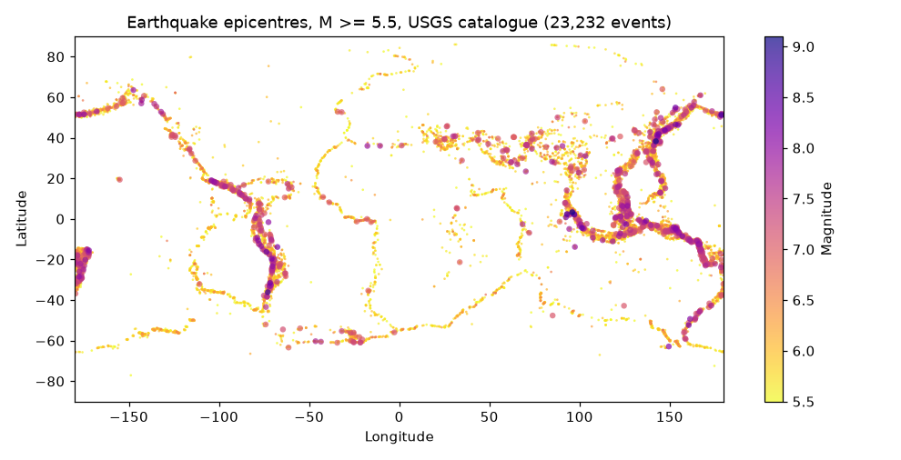

The epicentres trace the plate boundaries (the Pacific rim, the mid-ocean ridges, the Alpine-Himalayan belt), with the
largest events (purple) concentrated along the Chilean, Aleutian, Japanese and Sumatran subduction zones.

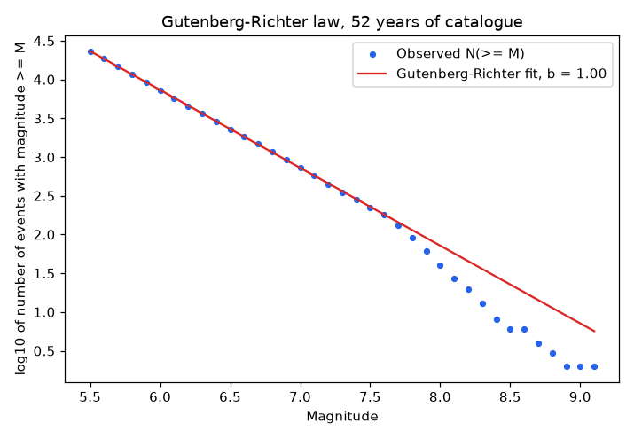

The observed counts follow the fitted line between M 5.5 and about M 7.6 and then fall below it. Counted from the
catalogue (computed for this document), 40 events reach M 8.0 where the fitted line implies 72.0, 6 reach M 8.5 where
it implies 22.7, and 2 reach M 9.0 where it implies 7.1.

#### Limitations and failure modes

- Aftershocks are not removed, so one large earthquake inflates the "rate" for years. In the Tokyo circle, 126 of the
  433 events are dated 2011, and 112 fall within 90 days after the 2011-03-11 mainshock. In the Los Angeles circle, 12
  of 43 events are from 1992 and 1994 (8 and 4). Busy sequences therefore read as "very high", and a place can be
  "very high" on the strength of a single sequence. Los Angeles shows this directly: 41 events before 2000 and 2
  after.
- The Poisson model assumes independent events at a constant rate. Real seismicity is clustered, and the rate over 52
  years is not stationary (414.0 per year before 2000, 514.3 after). Part of that may be catalogue completeness and
  magnitude-scale changes, which the code does not test.
- The b = 1.00 extrapolation overshoots at the top of the range: 72.0 predicted against 40 observed worldwide at M 8.0
  and above, so M 8 probabilities are likely overstated where the global b-value is used. At M 7.0 the global fit is
  close (725.7 implied against 738 observed, computed for this document), and where the sample is small a local
  b-value has a large error. The earthquake result page and the assistant's hazard-tool caveats state the M 8
  overshoot (40 events of M 8 or more observed against 72 implied) and say that the M 7 fit is close.
- Rates from fewer than about ten events are noisy, and a 10-year probability of 100% at high rates is a statement
  about the Poisson formula saturating, not certainty.
- The circle is a convenience. A 300 km radius mixes faults of very different activity, and an offshore or distant
  source counts the same as one under the point.
- The catalogue lists "significant" earthquakes. Completeness at M 5.5 is assumed and not tested, and it mixes
  magnitude types. It says nothing about shaking, depth effects, local geology or building quality.
- The level cut-offs are conventions. This is not an official hazard map and must not be used as one.
- The back-test splits at 2000 using fractional years (`_year_fraction`, 365.25-day years) rather than calendar years.
  That moves one event (14,490 events before the split against 14,489 by calendar year, computed for this document),
  so it does not change the result, but it is not an exact calendar split.

#### Where the code is

[hazard.py](../src/ndp/ml/hazard.py): `estimate_from_catalogue` (the whole computation on arrays), `predict` (loads
the saved catalogue), `train` and `_backtest`. Tests: [test_ml_phase2.py](../tests/ml/test_ml_phase2.py)
(`test_aki_b_value_recovers_known_b`, `test_antimeridian_and_poles`, `test_level_thresholds`). Reproduce with `uv run
ndp-train hazard`.

### 3.2 Earthquake catalogue statistics

#### Purpose and inputs/outputs

Descriptive statistics and plots for the "Graphical analysis" page: counts by magnitude band, month and year. It is
not a predictive model. The magnitude regression that used to live here had a held-out R-squared of about 0 and was
removed (see [legacy-2020.md](legacy-2020.md)).

#### Data

The same `database.csv`. `load_frame` keeps only rows with `Type == "Earthquake"` (the 180 explosions and the rock
burst are excluded, as in the hazard model), then drops rows missing `Date`, `Latitude`, `Longitude`, `Depth` or
`Magnitude`. That leaves 23,232 of the file's 23,412 rows. Dates are parsed to timestamps.

#### Method

No fitting. `_compute_stats` counts rows. The saved result (`earthquake_catalogue`) holds the minimum, maximum and
mean magnitude, the busiest year, and counts by year, month and magnitude band.

#### Validation

Not applicable.

#### Results

| Quantity | Value |
|---|---|
| Events | 23,232 |
| Magnitude min, max, mean | 5.5, 9.1, 5.88 |
| Busiest year | 2011 (713 events) |
| Quietest year | 1966 (233 events) |
| Magnitude 5 to 6 | 15,936 |
| Magnitude 6 to 7 | 6,558 |
| Magnitude 7 to 8 | 698 |
| Magnitude 8 to 9 | 38 |
| Magnitude 9 and above | 2 |

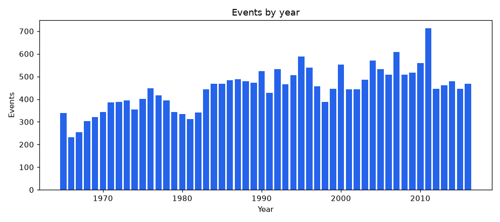

Yearly counts rise from 339 in 1965 to between 388 and 608 a year from 1984 on (outside 2011), with a spike to 713 in
2011 (the Tohoku aftershock sequence).

#### Limitations and failure modes

The catalogue is the same 23,232 earthquakes the hazard model uses, so the counts agree with it (before this was
fixed, the statistics included 180 explosions and a rock burst and reported 23,412). Yearly and monthly counts include
aftershocks. The magnitude bands start at 5 although the file's minimum is 5.5.

#### Where the code is

[catalogue.py](../src/ndp/ml/catalogue.py): `load_frame`, `_compute_stats`, `train`, `stats`.

### 3.3 Flood forecast

#### Purpose and inputs/outputs

Forecast the river level at one gauge (Hoppers Crossing, Victoria, Australia) 1, 3 and 6 hours ahead. Inputs, in the
order of `flood.predict`: `level_now_m`, `level_1h_ago_m`, `level_3h_ago_m`, the rainfall total over the last 3, 6 and
24 hours in millimetres. Output (`FloodForecast`): for each horizon the forecast level, the persistence level (the
current level), and the peak. This model is for one gauge and is not a flood warning.

#### Data

Two hourly files from Melbourne Water: rainfall (`Hoppers Crossing-Hourly-Rainfall.csv`, 78,848 rows, columns
`Date/Time`, `Current rainfall (mm)`, `Cumulative rainfall (mm)`, 2009-12-01 to 2018-12-02) and river level (`Hoppers
Crossing-Hourly-River-Level.csv`, 78,822 rows, `Date/Time`, `Level (m)`, 2009-12-02 to 2018-12-02). `load_hourly`
builds a gap-preserving hourly grid:

1. Both files are indexed by timestamp (naive local time). A handful of duplicated timestamps keep the first non-null
   value.
2. The two series are outer-joined and reindexed to a complete hourly grid of 78,931 hours (2009-12-01 00:00 to
   2018-12-02 18:00). An hour absent from a file stays NaN. Nothing is interpolated.
3. `Level (m) == 0` is the logger's outage code, not a river level, so it becomes NaN (85 hours in 14 runs, computed
   for this document).
4. Stuck sensor: runs of 168 or more consecutive identical readings become NaN (`mask_stuck`). This removes 11,157
   hours in nine stretches between 2010 and 2013: 8,112 hours at exactly 1.40 m, 1,964 at 1.54 m and 1,081 at five
   other values (computed for this document). The runs at 1.40 m and 1.54 m (10,076 hours) are the "about 10,000
   hours" referred to elsewhere.

After this, 67,579 hours have a known level and 11,352 do not (85 outage hours, 11,157 stuck-sensor hours and 110
hours missing from the file). Rows whose feature window or target touch any missing hour are dropped, leaving 66,739
usable rows.

#### Method

Features for the hour t use only data from t and earlier (`build_features`):

```
level_now = level[t]      level_1h_ago = level[t-1]      level_3h_ago = level[t-3]
rain_3h, rain_6h, rain_24h = sums of "Current rainfall" over the last 3, 6, 24 hours, including hour t,
                             requiring every hour in the window to be present (no partial sums)
d_level_1h = level_now - level_1h_ago        d_level_3h = level_now - level_3h_ago   (derived)
y_h = level[t + h]       the only forward-looking column; it is the target and never a feature
```

The model predicts the change over the horizon and adds the current level back:

```
level[t + h]  =  level_now  +  f_h(level_now, level_1h_ago, level_3h_ago, rain_3h, rain_6h, rain_24h,
                                   d_level_1h, d_level_3h)
```

One `HistGradientBoostingRegressor` per horizon (1, 3, 6 h), each with `max_iter=200`, `learning_rate=0.05`,
`max_leaf_nodes=15`, `min_samples_leaf=50`, `random_state=0`, squared-error loss. Because the training set has more
than 10,000 rows, scikit-learn's default early stopping is on (10% of the training rows, drawn at random, held out for
validation; stop after 10 rounds without improvement). The saved models used 48 (1 h), 39 (3 h) and 181 (6 h)
iterations (read from the saved artifacts). The validation rows are random rather than the latest, a small optimism in
stopping only; the test period is never used. The "flood" label compares the forecast with 1.44 m, but pages show
levels and changes only, never a verdict (see below).

#### Validation

Chronological. The 66,739 usable rows are sorted by time; the last 20% are the test set, and the last six training
rows are dropped so that no training target (up to 6 h ahead) falls inside the test period. Train: 53,385 rows,
2009-12-02 03:00 to 2017-05-04 13:00. Test: 13,348 rows, 2017-05-04 20:00 to 2018-12-02 11:00. Because early years
have large gaps, "last 20% of rows" is about the last 19 months rather than 20% of the calendar.

#### Results

Headline (3 h): RMSE 0.0233 m, R² 0.88, against persistence RMSE 0.0261 m, skill +0.11. By horizon:

| Horizon | Model RMSE (m) | Persistence RMSE (m) | Skill vs persistence | Rises of 10 cm or more | Recall | Precision |
|---|---:|---:|---:|---:|---:|---:|
| 1 h | 0.0132 | 0.0146 | +0.09 | 44 | 0% | n/a |
| 3 h | 0.0233 | 0.0261 | +0.11 | 126 | 7% | 45% |
| 6 h | 0.0373 | 0.0403 | +0.07 | 216 | 2% | 22% |

A "rise" is a test hour where the level at t + h exceeds the level now by at least 0.10 m. Recall is the share of
those rises that the model also forecast at 0.10 m or more; precision is the share of its rise forecasts that were
right. Counts behind the percentages (derived): at 1 h the model made no rise forecast (so precision is undefined) and
caught 0 of 44; at 3 h it made 20 and 9 were right (9 of 126 caught); at 6 h it made 23 and 5 were right (5 of 216
caught). The sidecar also records R² of 0.961, 0.880 and 0.693 for 1, 3 and 6 h. R² is high mainly because levels
persist: persistence alone scores 0.953, 0.849 and 0.642 on the same rows (computed for this document), so skill, not
R², is the measure of value. The mean absolute error improves on persistence by about 1% at 1 h (0.00315 m against
0.00318 m), 7% at 3 h (0.00674 against 0.00723) and 6% at 6 h (0.01128 against 0.01197) (derived).

Example forecasts from `statistics.md` (inputs: levels now, 1 h and 3 h ago in metres; rain over 3, 6, 24 h in mm):

| Case | +1 h | +3 h | +6 h | Peak vs now |
|---|---:|---:|---:|---:|
| Quiet day (1.42, 1.41, 1.40; 2, 3, 5) | 1.431 m | 1.427 m | 1.437 m | +0.017 m |
| Heavy rain, level rising (1.90, 1.70, 1.50; 40, 60, 90) | 1.977 m | 2.029 m | 1.828 m | +0.129 m |

The three horizons are separate models, so the forecast curve need not be smooth. In the second case the 6 h value is
below the 3 h value.

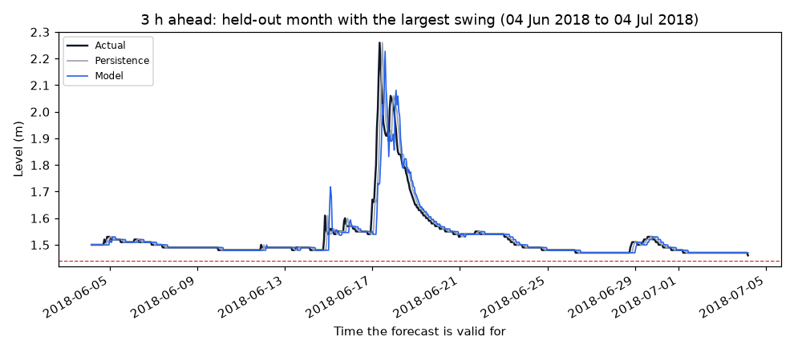

This is the 30-day held-out window with the largest level swing (2018-06-04 to 2018-07-04), chosen by `_plot_forecast`
to be easy to read, not a typical month. The persistence line is the actual line shifted by 3 hours, so it lags every
rise. The model line is closer to the actual line on the big rise and fall around 17 June, but it also produces a
spurious spike near 15 June (roughly 1.7 m against an actual of about 1.6 m) and wobbles near the peak.

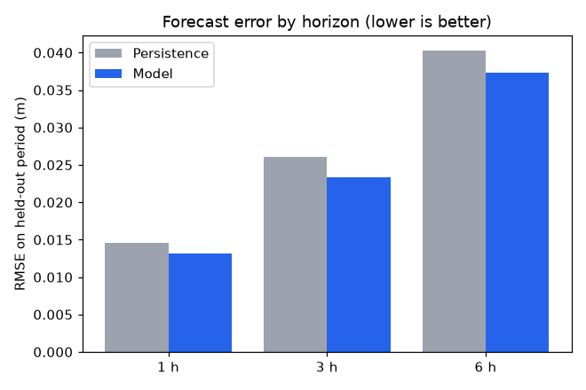

The model bar is below the persistence bar at each horizon, by a margin of 7% to 11% of the persistence error (skill
+0.09, +0.11, +0.07).

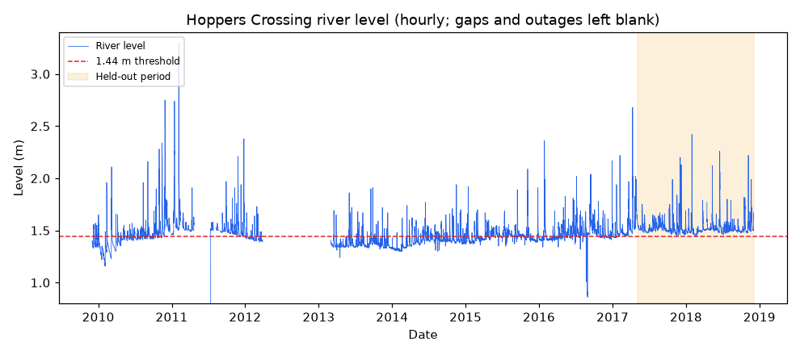

The record has long blank stretches (masked outages and stuck-sensor periods, mostly in 2011 to 2013), and the base
level sits below the dashed 1.44 m line in most of 2013 to 2014 and above it in 2017 to 2018, which is the shaded
held-out period.

#### Limitations and failure modes

- It mostly misses sudden rises. Recall for rises of 10 cm or more is 0% at 1 h, 7% at 3 h and 2% at 6 h on the
  held-out period. The gain over persistence comes from smoothing small moves, not from anticipating floods.
- The 1.44 m "flood level" from the 2020 project is not informative. The gauge's base level drifted up and the
  threshold sits at the median of the record (the median known level is 1.45 m, and 55% of known hours are above 1.44 m). The share of known hours above 1.44 m by
  year is 11.1% (2009), 36.8% (2010), 98.9% (2011), 17.6% (2012), 7.5% (2013), 17.0% (2014), 47.0% (2015), 56.0%
  (2016), 97.7% (2017) and 100% (2018). Every held-out hour is above it (minimum 1.45 m), so the sidecar's flood
  precision and recall of 1.0 for both the model and persistence mean nothing. Pages therefore show forecast levels
  and changes, never "flood" or "no flood".
- One gauge, one catchment. There is no upstream gauge, no rainfall forecast and no knowledge of dam or weir
  operation, so the model cannot see a flood wave coming.
- Only 2.6% of held-out hours have rain in the last 3 hours (computed for this document), so the rainfall features are
  exercised very little in the test period. Large events are rare, so the test set contains few of them.
- Inputs outside the training range are extrapolated by trees as the nearest leaf, so forecasts for readings far from
  anything in 2009 to 2018 are not meaningful. The assistant tool clamps readings to 0 to 15 m and 0 to 500 mm (the same cap as the form and the API), which does not make them valid.
- About 14% of the hourly grid has no usable level (11,352 of 78,931 hours). The early record is thin: 2012 has 2,074
  known hours against 8,722 to 8,759 for each of 2014 to 2017 (computed for this document), so most training rows come
  from 2013 onward.
- A fixed 6-row (not 6-hour) gap is dropped from the training set. Here the boundary rows are contiguous hours, so the
  two are the same.

#### Where the code is

[flood.py](../src/ndp/ml/flood.py): `load_hourly`, `mask_stuck`, `build_features`, `chronological_split`, `train`,
`predict`. Tests: [test_ml_phase2.py](../tests/ml/test_ml_phase2.py)
(`test_flood_features_do_not_depend_on_the_future`, `test_flood_chronological_split_has_no_overlap`,
`test_mask_stuck_sensor_runs`). Reproduce with `uv run ndp-train flood`.

### 3.4 Tsunami

#### Purpose and inputs/outputs

Estimate the source (earthquake) magnitude of a historical tsunami from where it was observed and the maximum water
height. Inputs: `lat`, `lon`, `max_height_m`. Output: a magnitude and a flag `risk`, true when the estimate is 6.5 or
more. The height is an outcome of the event, so this estimates a source from an observation; it does not predict a
tsunami in advance.

#### Data

`tsunami.csv` (NOAA NCEI, 2,582 rows, 45 columns, years from 2000 BC to 2017). Columns used: `LATITUDE`, `LONGITUDE`,
`MAXIMUM_HEIGHT` (features) and `PRIMARY_MAGNITUDE` (target). Cleaning in `load_frame`: values are coerced to numbers,
and rows with no magnitude are dropped (1,123), leaving 1,459. Missing feature values are left as NaN for the model's
imputer (see Method). Of the 1,459 rows, 664 (45.5%) have no recorded height, and 14 lack a latitude and 14 a
longitude (computed for this document); 795 rows have all three features. The target has mean 7.04, standard deviation
0.80, range 3.2 to 9.5, and 80.7% of rows are 6.5 or above.

#### Method

A pipeline of `SimpleImputer(strategy="mean")` followed by `RandomForestRegressor(n_estimators=300,
min_samples_leaf=3, random_state=0)`, with `n_jobs=-1` during training and set to 1 before saving. The imputer learns
each feature's mean from the rows the pipeline is fitted on, so every cross-validation fold and the final model use
only their own training rows. The final model's means are latitude 17.03, longitude 53.01 and height 4.62 m (read from
the saved pipeline). Earlier versions filled missing values with a mean computed on all rows before the split, which
leaked test rows into the fill value; that was fixed by moving the imputer inside the pipeline. Prediction is the
average of the trees' leaf means. The risk flag is `magnitude >= 6.5`.

#### Validation

`train_test_split(test_size=0.25, random_state=0)` gives 1,094 training and 365 test rows, plus 5-fold shuffled
cross-validation over all rows. Events are independent historical records with no forecast order, so a random split is
acceptable; but regional clusters (one earthquake with several observation points) may sit on both sides of the split,
which would make the numbers optimistic.

#### Results

| Measure | Value |
|---|---|
| Held-out RMSE | 0.655 |
| Held-out MAE | 0.493 |
| Held-out R² | 0.27 (0.2705) |
| Baseline (training mean) RMSE, R² | 0.772, -0.012 |
| Skill | +0.15 |
| 5-fold CV R² | 0.22 ± 0.10 (0.2233 ± 0.1008) |

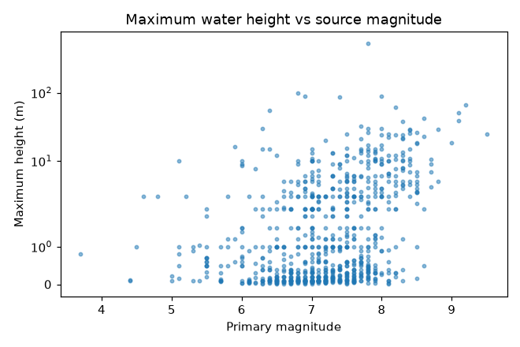

Only rows with a recorded height are drawn (the imputed rows are not in the plot). Heights rise on average with
magnitude, from a metre or so and below near M 5 to several metres and occasionally tens of metres above M 8, but the scatter
at any magnitude spans one to two orders of magnitude, which is why a height-only fit has low skill.

#### Limitations and failure modes

- Almost half of the rows (664 of 1,459, 45.5%) have no recorded height and are given the training mean (4.62 m in the
  saved model), so for them the model sees almost only location. The earlier leakage of test rows into the imputation
  mean is fixed (the imputer now sits inside the pipeline and cross-validation).
- The error of 0.66 magnitude units is about 0.8 of the target's standard deviation, and the split R² (0.27) is higher
  than the cross-validated mean (0.22), so expect the lower figure.
- The `risk` flag is nearly uninformative: 80.7% of known events are at least 6.5, so "true" is the expected answer
  for most inputs.
- Wave height depends on distance to the source, bathymetry and the coast, none of which are inputs.
- Historical records (some from antiquity) are uneven in coverage and quality.

#### Where the code is

[tsunami.py](../src/ndp/ml/tsunami.py): `load_frame`, `train`, `predict`. Reproduce with `uv run ndp-train tsunami`.

### 3.5 Hurricane

#### Purpose and inputs/outputs

Estimate the maximum sustained wind (knots) at a track point from the date and position. Inputs: date, latitude,
longitude. Output: wind in knots, a Saffir-Simpson category (tropical depression below 34 kt, tropical storm below 64,
then categories 1 to 4 at upper bounds 83, 96, 113 and 137, category 5 above), and `is_hurricane` (64 kt or more). The
model does not know which storm a point belongs to, so it is a climatology of where and when strong winds occur, not a
storm forecast.

#### Data

`hurricane-atlantic.csv` (49,105 rows) and `hurricane-pacific.csv` (26,137 rows), NOAA HURDAT2, 22 columns each,
1851-06-25 to 2015-11-29. Columns used: `Date` (yyyymmdd), `Latitude`, `Longitude` (strings such as "28.0N" and
"94.8W", parsed to signed numbers by `parse_hurdat_coord`) and `Maximum Wind` (target, knots). Rows with the sentinel
wind -99 are dropped (338 of 75,242, computed for this document), leaving 74,904 track records.

#### Method

Features: `lat`, `lon`, `day_of_year` and `abs_lat` (the year is deliberately excluded). One
`HistGradientBoostingRegressor(max_iter=200, learning_rate=0.05, max_leaf_nodes=15, min_samples_leaf=40,
random_state=0)`. Early stopping was available (auto) but the saved model ran all 200 iterations.

#### Validation

Chronological at the year 2005: 63,505 rows before it (1851 to 2004) train, 11,399 rows from 2005 to 2015 test. Track
records of a storm are strongly dependent, and the split keeps whole seasons on one side.

#### Results

| Measure | Value |
|---|---|
| Held-out RMSE (kt) | 24.47 |
| Held-out MAE (kt) | 19.31 |
| Held-out R² | 0.04 |
| Baseline (training mean) RMSE, R² | 25.87, -0.07 |
| Skill | +0.05 |

The training mean wind is 52.6 kt and the test mean is 46.0 kt (computed for this document), so part of the baseline's
error is a mean shift. Against a baseline that knew the test mean (RMSE 25.00, the test standard deviation), the skill
would be +0.02 (derived).

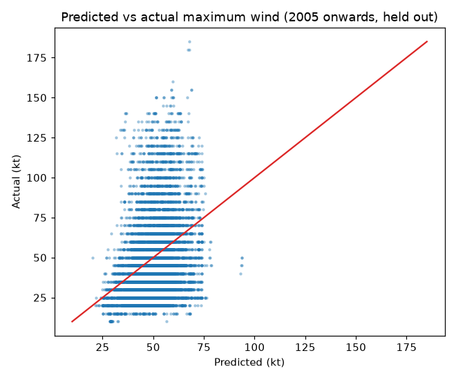

Predictions stay in a narrow band from about 20 to 95 kt while actual winds span 10 to 185 kt, so the cloud is tall
and narrow rather than along the identity line: position and day of year say little about intensity.

#### Limitations and failure modes

- Skill is close to nothing. Predictions barely vary, so strong storms are heavily under-predicted (no prediction
  above about 95 kt in the plot, against actual winds up to 185 kt).
- No storm identity, history, pressure, sea temperature or shear is used.
- Pre-satellite era records (1851 onward) are less reliable than modern ones, and are pooled into training. Basin
  differences are not modelled beyond latitude and longitude.
- The category labels turn a point estimate with an RMSE of 24.5 kt into a crisp class, although the error is as wide
  as any hurricane category (categories 1 to 4 span 13 to 24 kt). Do not read the category as a forecast.

#### Where the code is

[hurricane.py](../src/ndp/ml/hurricane.py): `load_frame`, `model_frame`, `train`, `predict`, `category_for`. Test:
`test_hurricane_split_is_chronological_at_2005` in [test_ml_phase2.py](../tests/ml/test_ml_phase2.py). Reproduce with
`uv run ndp-train hurricane`.

### 3.6 Storm (weather class)

#### Purpose and inputs/outputs

Classify an hourly surface observation into one of four weather descriptions: rain, sky is clear, snow, thunderstorm.
Inputs: temperature (the form labels it degrees Fahrenheit), pressure (hPa), humidity (%), wind direction (degrees),
wind speed (unit not documented in the file or code). Output: the top class and up to three classes with their forest
vote shares.

#### Data

`weather_data.csv`: 1,020 rows, 6 columns, no missing values. The four classes have exactly 255 rows each (computed
for this document), which suggests a curated or resampled file; real weather is not balanced. Value ranges:
temperature 5.0 to 90.2, pressure 991 to 1,038, humidity 21 to 100, wind direction 0 to 360, wind speed 0 to 13. There
is no timestamp column.

#### Method

Two candidates are compared by 5-fold stratified cross-validated accuracy on the training split, and the better one is
refit and kept: `DecisionTreeClassifier(min_samples_split=20)` and `RandomForestClassifier(n_estimators=300,
min_samples_leaf=2)`, both with `random_state=99`. The forest won (CV accuracy 77.8% ± 2.7 against 69.5% for the
tree). The prediction page shows the three most likely classes using the forest's vote shares, which are not
calibrated probabilities.

#### Validation

Stratified random 80/20 split (`random_state=99`): 816 training rows and 204 test rows. With no timestamps a
chronological split is impossible, so neighbouring hourly rows may sit on both sides of the split and inflate
accuracy.

#### Results

| Measure | Value |
|---|---|
| Held-out accuracy | 74.0% (151 of 204, derived) |
| Baseline (most common class) | 25.0% |
| Skill | +0.65 |
| 5-fold CV accuracy on the training part | 77.8% ± 2.7 |
| Decision tree CV accuracy | 69.5% |

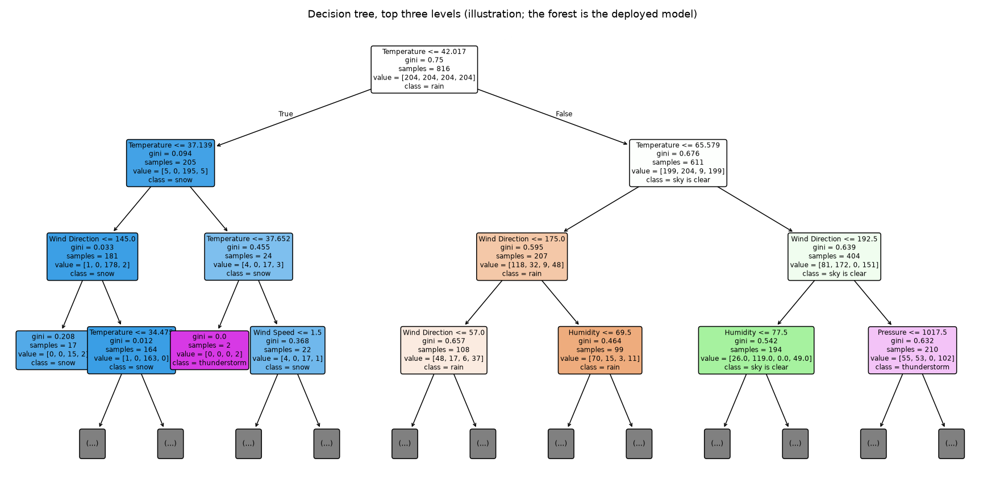

This is an illustration of the data, not the deployed forest. The root splits on temperature at 42.0 (the cold branch
of 205 of the 816 training rows is almost all snow), and the warm branches need wind direction, humidity and pressure
to separate rain, clear sky and thunderstorm.

#### Limitations and failure modes

- Small sample: with 204 test rows the standard error of the accuracy is about 3.1 points (derived), so the held-out
  74.0% and the cross-validated 77.8% are consistent with each other. The gap to the baseline is large, but the exact
  accuracy is uncertain by several points.
- The baseline is 25% only because the classes are balanced. Real observations are rarely balanced, so both
  the baseline and the accuracy would change on an unmanipulated sample.
- Temporal leakage between adjacent hours cannot be ruled out, so true accuracy on a new period or place may be lower.
  No per-class results or confusion matrix are saved, so it is unknown which classes are confused.
- It describes the weather at the time of the reading. It is not a forecast, and it has no notion of severity or
  location.

#### Where the code is

[storm.py](../src/ndp/ml/storm.py): `load_frame`, `_candidates`, `train`, `predict`. Test:
`test_storm_train_and_predict` in [test_ml_fast.py](../tests/ml/test_ml_fast.py). Reproduce with `uv run ndp-train
storm`.

### 3.7 Model comparison

#### Purpose and inputs/outputs

A page that shows, for four hazards, how a random forest, a neural network, a support-vector machine and linear
regression do next to a "predict the mean" baseline on the same split, and lets you enter inputs and see each model's
prediction. It is a teaching comparison carried over from the 2020 project, not a set of production forecasters.

#### Data

Each hazard has a loader (`HAZARDS` in [compare.py](../src/ndp/ml/compare.py)):

| Hazard | Features | Target | Rows before subsampling |
|---|---|---|---:|
| Earthquake | Latitude, Longitude, Depth | Magnitude | 23,232 (earthquakes only, see 3.2) |
| Tsunami | LATITUDE, LONGITUDE, MAXIMUM_HEIGHT | PRIMARY_MAGNITUDE | 795 (of 1,459; rows with a missing feature are dropped, nothing is imputed) |
| Flood | Current rainfall (mm), Cumulative rainfall (mm) | Level (m) | 67,577 |
| Hurricane | Date (yyyymmdd integer), Latitude, Longitude | Maximum Wind | 74,904 |

Rows with a missing value are dropped, which is why the tsunami comparison uses 795 rows rather than the 1,459 of
section 3.4. If there are more than 15,000 rows, 15,000 are drawn at random (`random_state=0`); `--quick` uses 3,000.
Subsampling applies to earthquake, flood and hurricane and not to the tsunami data. The code does not say why; the
likely reasons are the cost of the SVM and neural network and the size of the artifacts (up to 81.4 MB for the
earthquake comparison).

#### Method

Each model is a pipeline of `StandardScaler` followed by: `RandomForestRegressor(n_estimators=100)`,
`MLPRegressor(hidden_layer_sizes=(100,), max_iter=1500)`, `SVR()` (RBF kernel, C=1, epsilon=0.1, the scikit-learn
defaults), `LinearRegression()`, or `DummyRegressor(strategy="mean")`, all with `random_state=0` where they accept
one. Metrics per model: tolerance accuracy, R², RMSE and skill against the mean baseline.

#### Validation

A shuffled `train_test_split(test_size=0.25, random_state=0)` with the same rows for every model. This is not
chronological, which is wrong for the flood, hurricane and earthquake data (see section 1) and makes every model look
better than it would on new data.

#### Results

Earthquake (15,000 rows of 23,232):

| Model | Tolerance accuracy | R² | RMSE | Skill |
|---|---:|---:|---:|---:|
| Random forest | 95.2% | -0.11 | 0.438 | -0.05 |
| Neural network | 95.5% | -0.000501 | 0.416 | +0.00 |
| SVM | 93.8% | -0.04 | 0.423 | -0.02 |
| Linear regression | 95.1% | 0.00381 | 0.415 | +0.00 |
| Baseline (predict the mean) | 95.0% | -0.00132 | 0.416 | +0.00 |

Tsunami (795 rows, no subsampling):

| Model | Tolerance accuracy | R² | RMSE | Skill |
|---|---:|---:|---:|---:|
| Random forest | 87.9% | 0.16 | 0.679 | +0.09 |
| Neural network | 87.4% | 0.15 | 0.683 | +0.08 |
| SVM | 87.9% | 0.19 | 0.667 | +0.10 |
| Linear regression | 83.9% | 0.08 | 0.710 | +0.05 |
| Baseline (predict the mean) | 81.9% | -0.00948 | 0.744 | +0.00 |

Flood (15,000 rows, level from current and cumulative rainfall):

| Model | Tolerance accuracy | R² | RMSE | Skill |
|---|---:|---:|---:|---:|
| Random forest | 98.9% | 0.27 | 0.086 | +0.15 |
| Neural network | 98.9% | 0.27 | 0.086 | +0.14 |
| SVM | 99.1% | 0.29 | 0.084 | +0.16 |
| Linear regression | 99.0% | 0.28 | 0.085 | +0.15 |
| Baseline (predict the mean) | 98.2% | -0.00173 | 0.100 | +0.00 |

Hurricane (15,000 rows):

| Model | Tolerance accuracy | R² | RMSE | Skill |
|---|---:|---:|---:|---:|
| Random forest | 65.6% | 0.42 | 18.991 | +0.24 |
| Neural network | 48.9% | 0.12 | 23.262 | +0.06 |
| SVM | 58.9% | 0.03 | 24.465 | +0.02 |
| Linear regression | 41.9% | 0.05 | 24.237 | +0.02 |
| Baseline (predict the mean) | 38.1% | -0.000448 | 24.843 | +0.00 |

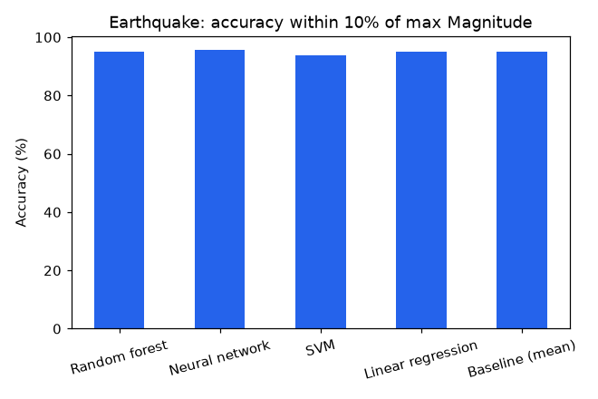

All five bars, including "predict the mean", sit between 93.8% and 95.5%, which is why tolerance accuracy cannot tell
these models apart; RMSE shows that none beats the baseline.

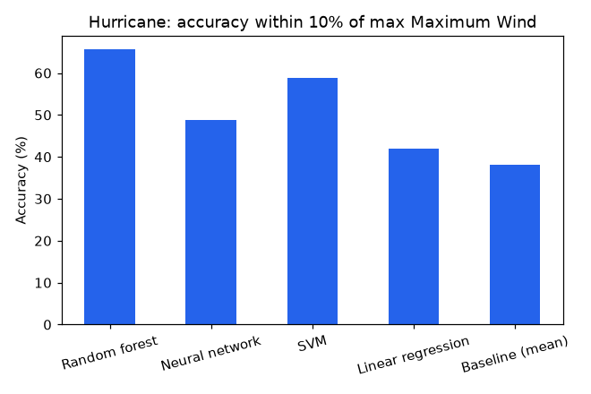

Here the bars do separate (random forest 65.6% against 38.1% for the baseline), and the same pattern appears in skill
(+0.24 for the forest).

Reading the tables:

- Earthquake: nothing beats the mean. The comparison page prints "No model beats the baseline" when the best RMSE is
  within 2% of the baseline's.
- Flood: all four models show skill of +0.14 to +0.16, but the target is the absolute level from rainfall at the same
  hour. The level drifts by year (section 3.3), so any input that correlates with the period beats the mean. That is
  probably the source of the skill and is not a forecast (not tested).
- Hurricane: the forest's +0.24 compares with +0.05 for the chronological model of section 3.5 on the same data. With
  a shuffled split, points of the same storm fall on both sides, and the raw date is a feature, so the forest can
  effectively look up neighbours. The comparison is the clearest demonstration in the project of how a shuffled split flatters a model.
- Tsunami: skill is +0.05 to +0.10 for the four models (best: SVM, +0.10) on 795 complete rows, against +0.15 for the
  single model of section 3.4 on 1,459 rows with an imputer. The row sets differ, so the numbers are not directly
  comparable.

#### Limitations and failure modes

Shuffled splits, subsampling, mean-baseline only (no persistence), models with default hyperparameters and no tuning,
and a metric (tolerance accuracy) that rewards a constant. Use the numbers to compare model families on an equal
footing, not to judge any hazard.

#### Where the code is

[compare.py](../src/ndp/ml/compare.py): `build_models`, `train`, `train_all`, `predict`, `metrics`; `HAZARDS` defines
inputs. Test: `test_compare_train_predict_roundtrip` in [test_ml_fast.py](../tests/ml/test_ml_fast.py). Reproduce with
`uv run ndp-train compare`.

### 3.8 Sentiment

#### Purpose and inputs/outputs

Score the tone of scraped forum posts about seven past disasters with SentiWordNet, and compare the scores with a
monetary-impact figure carried over from the 2020 project. Input: a disaster's CSV of posts (or, on the page, free
text through `score_text`). Output: one number per disaster. Nothing is learned from the data; this is a fixed rule
set, so there is no training split and no held-out result.

#### Data

Seven CSVs with columns `user`, `date`, `comment`; rows missing any of the three are dropped.

| Disaster | Monetary impact (2020 figure, unit undocumented) | Sentiment score | Posts | Sentences |
|---|---:|---:|---:|---:|
| Japan 2016 earthquake | 1.21 | -25.6 | 99 | 517 |
| Japan 2011 tsunami | 360 | -342.0 | 2,258 | 31,778 |
| Chennai 2015 flood | 42.04 | -46.8 | 513 | 4,828 |
| Kerala 2018 flood | 112.72 | -127.4 | 887 | 10,526 |
| Nepal 2015 earthquake | 0.013 | -15.7 | 99 | 720 |
| Indonesia (Palu) 2018 tsunami | 0.0131 | -7.0 | 71 | 269 |
| Cyclone Phailin 2013 | 0.655 | -11.0 | 248 | 2,690 |

Totals: 4,175 posts and 51,328 sentences. The impact figures are hard-coded in `DISASTERS` in
[sentiment.py](../src/ndp/ml/sentiment.py); their unit and source are not documented anywhere in the repository
(`statistics.md` prints Indonesia as 0.013 because it rounds to three decimals).

#### Method

The rules are a port of the 2020 code. For each post:

1. Split the comment into "sentences" with a plain `split(".")` (so "6.5" and "Dr. Rao" split, and empty fragments are
   scored as 0).
2. Tokenise with NLTK and tag parts of speech (`pos_tag_sents`, averaged perceptron).
3. Lower-case; replace characters in a delimiter set with spaces (the set is built as a regex character class that
   contains a range, `*-@`, which covers digits and the characters `+ , - . / : ; < = > ? @`); drop numeric tokens;
   drop NLTK English stopwords plus a list of punctuation and digit characters.
4. Walk the remaining tokens and keep a running adverb score:

```
adverb  (RBS 1.5, RBR 1.2, RB 1.0):  adv += weight * s(word, "r")
adjective (JJS 1.5, JJR 1.2, JJ 1.0): score += (0.4 * adv + 1) * weight * s(word, "a");  adv = 0
verb (VB VBD VBG VBN VBP VBZ):        score += (0.4 * adv + 1) * s(word, "v");           adv = 0
all other tags: ignored
```

5. `s(word, pos)` (`cal_score`) walks the SentiWordNet senses of the word for that part of speech in WordNet order,
   collects each sense's positive and negative score, stops after the first sense where both are 0, and returns
   `max_pos` if `max_pos > max_neg`, otherwise `-max_neg` (a tie is negative, and a word with no senses scores 0).
6. A post's score is the sum of its sentence scores. Posts are grouped by (date, user), where the date is the first
   three whitespace-separated tokens of the date string; each group takes the mean of its posts, and the disaster's
   score is the sum of the group means.

Worked examples (run for this document with `sentiment.score_text`): "The rescue was good" scores 0.75; "The rescue
was extremely good" scores 0.9375, which is `(0.4 * 0.625 + 1) * 0.75`; "I am so sad" scores -1.0; "We lost
everything" scores -0.5.

#### Validation

None. There is no labelled sentiment in the repository, so the scorer is not evaluated against human judgement. The
unit tests (`test_score_text_signs`, `test_cal_score_rules`) check that the code applies the rules, not that the rules
are right.

#### Results

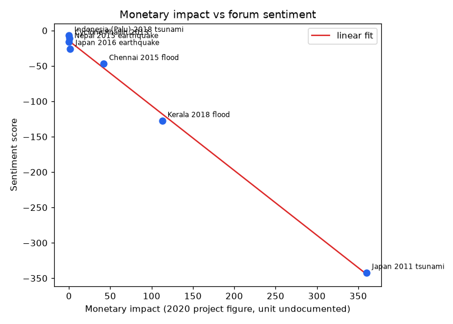

The seven points lie close to a falling straight line (Pearson r of -0.998, derived), driven by the Japan 2011 tsunami
at the far right (impact 360, score -342.0). The other six disasters are bunched at the left, between impact 0.013 and
112.72, and four of them overlap so that their labels collide. The x-axis reads "Monetary impact (2020 project figure,
unit undocumented)", which is the accurate description of that figure.

#### Limitations and failure modes

- Negation and most intensifiers are discarded. NLTK's stopword list contains "not", "no", "very" and "so", so "The
  rescue was not good" scores the same as "The rescue was good" (0.75), and "very" never reaches the adverb rule.
  Words such as "really" and "extremely" do.
- The score is a sum over (date, user) groups, so it grows with the amount of discussion as well as its tone.
  Correlations with the score across the seven disasters are -0.998 for monetary impact, -0.992 for post count and
  -0.995 for sentence count (derived), so the data cannot separate "worse disasters feel more negative" from "bigger
  disasters have more posts". Score per post (derived) is -0.26 for Japan 2016, -0.16 for Nepal, -0.15 for Japan 2011,
  -0.14 for Kerala, -0.10 for Indonesia, -0.09 for Chennai and -0.04 for Phailin, which reorders the disasters.
- With seven points and one dominant point, any fit to the impact figure says nothing about causation. The impact
  figure itself has no documented unit or source.
- Lexicon scoring ignores context, sarcasm, code-switching and non-English text, and nouns are skipped entirely.
  "Please help us, we are stuck" scores +0.625 (run for this document), because "help" is a positive verb, while
  "Water is rising and we are stranded on the first floor" scores -0.125.
- Sentence splitting on "." and the quirky delimiter class are inherited from 2020 for fidelity.
- Posts are scraped forum comments of unknown sampling; they are not a random sample of public opinion.

#### Where the code is

[sentiment.py](../src/ndp/ml/sentiment.py): `score_tagged_sentence`, `cal_score`, `filtered_text`, `score_dataset`,
`train`, `score_text`. Reproduce with `uv run ndp-train sentiment` (about 22 s; it downloads NLTK data on first use).

### 3.9 COVID-19 case curve

#### Purpose and inputs/outputs

A curve fit to India's cumulative confirmed COVID-19 cases in early 2020, kept for continuity with the 2020 project.
Input: a date. Output: a predicted cumulative count (rounded, never below 0). It is an extrapolation of a curve in
time, not an epidemic model.

#### Data

`time_series_covid19_confirmed_global.csv` (JHU CSSE, 266 rows, 121 columns). `load_series` selects rows where
`Country/Region == "India"` (summed across rows if there were several), and takes the date columns (from the fifth
column on; 117 dates, 2020-01-22 to 2020-05-17). The series is 0 on the first day, first reaches 1 on 2020-01-30 and
ends at 95,698. The feature is `day_index`, days since 2020-01-22; the target is the raw count (not scaled).

#### Method

`make_pipeline(StandardScaler(), MLPRegressor(hidden_layer_sizes=(64, 64, 64), max_iter=3000, random_state=0))` (ReLU
units, Adam). The network reached `max_iter` (the saved model reports 3,000 iterations), so it stopped at the
iteration limit rather than on the convergence tolerance; `ndp-train` suppresses the scikit-learn convergence warning.
For the deployed model the same pipeline is refit on all 117 days, and the 90-day forecast (2020-05-18 to 2020-08-15)
is clipped at 0.

#### Validation

Chronological hold-out: with `cut = int(117 * 0.8) = 93`, the first 93 days (2020-01-22 to 2020-04-23, maximum 23,077
cases) train a model and the last 24 days (2020-04-24 to 2020-05-17, 24,530 to 95,698 cases) test it. The entire test
range lies above anything seen in training, so the test is a pure extrapolation. Two extra baselines are scored on the
same 24 days: the last training value held flat (`last_value_rmse`) and a straight line fitted to the training days
(`linear_trend_rmse`).

#### Results

| Measure | Value |
|---|---|
| Held-out RMSE | 28,551 |
| Held-out MAE | 22,291 |
| Held-out R² | -0.72 |
| Mean baseline RMSE, R² | 55,846, -5.58 |
| Skill vs mean (headline) | +0.49 |
| Last-value RMSE (skill, derived) | 37,917 (+0.25) |
| Linear-trend RMSE (skill, derived) | 47,845 (+0.40) |
| In-sample R² of the refit model | 0.9996 |

The negative R² says the model is worse than knowing the held-out mean, which a forecaster would not know; the
baselines above are the fair comparison. In-sample R² is a curve fit and is not evidence of forecasting ability.

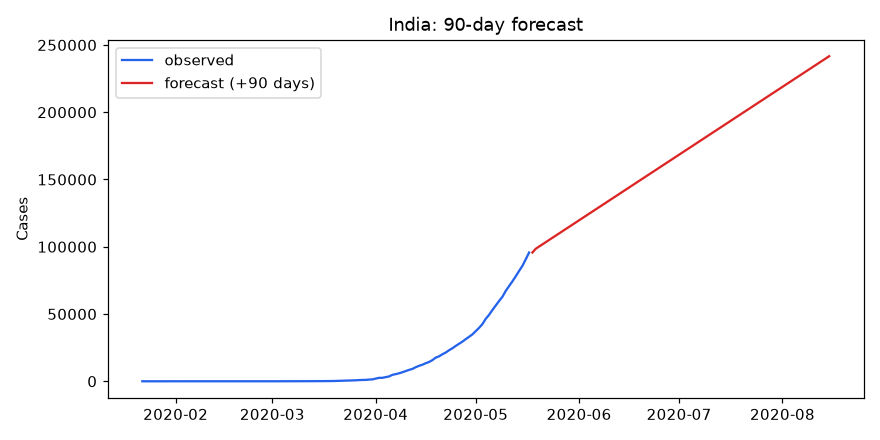

The forecast is a straight line from about 95,700 on the first forecast day (95,708 for 2020-05-18) to 241,638 at day
90 (values from the saved model, computed for this document). It rises about 1,626 cases a day between day 30 and day
90 of the horizon, less than half the 4,077 a day the series averaged over its last seven days (derived).

#### Limitations and failure modes

- A ReLU network extrapolates as a straight line beyond its training range, so the forecast shape comes from the
  activation function, not from epidemiology. It cannot represent acceleration, saturation or waves.
- The recent growth was faster than the forecast slope, so the forecast flattens a curve that was steepening. The
  repository has no data after 2020-05-17, so nothing can be checked.
- 93 training days and 24 test days is a tiny evaluation; the beat over last-value and linear-trend baselines rests on
  one 24-day window and one seed.
- The target is not scaled and the network did not converge, so results can change with the library version or seed.
- Reported cases depend on testing and reporting practice, which this series does not describe.
- Do not use it for planning. The page itself says that dates after the last data day are an extrapolation.

#### Where the code is

[covid.py](../src/ndp/ml/covid.py): `load_series`, `train`, `predict` (the file also holds the 2020 map snapshots and
test-centre lookup, which are not models). Web tests: [test_covid.py](../tests/web/test_covid.py). Reproduce with `uv
run ndp-train covid`.

## 4. Claude-powered features

Three features call Claude: the assistant, post triage and alert translation. They are not trained models, they have
no held-out numbers, and they are not covered by the sections above.

**No live API call was made during development.** The project was built without an API key. All tests use scripted
fakes (`fake_model`, `fake_parse` and a replaced `get_client`), and `ndp-eval` without a key prints a skip message.
Nothing here has been measured against the real model: the quality of answers and triage, whether the live API accepts
the request shapes (strict tool schemas, `output_format` structured output, the server-side fallback beta), latency,
cache hit rates and cost are all unverified. The only check run was that the installed SDK (anthropic 2.3.0)
accepts the keyword arguments the code passes (`betas`, `fallbacks`, `output_format`); that checks signatures, not the
service. Model names and prices in the eval cost table come from a snapshot of a model catalogue and were not checked
against the API.

### 4.1 Configuration and shared client

Every call goes through [llm.py](../src/ndp/services/llm.py).

| Setting | Value |
|---|---|
| Model | `NDP_ANTHROPIC_MODEL`, default `claude-opus-5-5` (a cheaper model is the suggested choice for a public deployment) |
| API key | `NDP_ANTHROPIC_API_KEY` or `ANTHROPIC_API_KEY`; without it the pages say Claude is not configured and everything else works |
| Client | One cached client, 60 s timeout, 2 retries |
| Sampling | No temperature, top_p, top_k, prefill or forced tool choice; the prompts steer behaviour |
| Refusals | `stop_reason == "refusal"` is a normal response and is handled by each caller. For models in `FALLBACK_MODELS`, `create_message` requests server-side fallbacks; `llm.parse` (used by triage) does not |
| Errors | SDK exceptions become `ServiceError` with a message safe to show (bad key, model not found, rate limit, timeout, connection, 5xx) |
| Usage | Token counters per process (`usage_totals`) for the eval runners |

### 4.2 Assistant

A chat page that answers questions about hazards, live events and preparedness using nine read-only tools. Code:
[assistant.py](../src/ndp/services/assistant.py), `ask`.

How a turn works: the user message is cleaned (Unicode-normalised, control and zero-width characters removed, at most
1,500 characters), then a manual loop calls the model with the system prompt and tool definitions. While the model
asks for tools, they run (several in parallel, up to four threads), and all results of one assistant turn go back in
one user message; a failing tool returns an error result rather than raising. At most `NDP_ASSISTANT_MAX_TOOL_ROUNDS`
(default 6) rounds of tool use are allowed, after which the model is told to answer from what it has; the loop has a
hard bound of rounds plus 4 API calls. A turn that is refused, empty or cut off in a tool call is not stored in the
session. Answers are capped at 4,096 output tokens, and a truncated answer gets a note. The system prompt is one
cached block and the tools are listed in fixed (alphabetical) order, so one cache breakpoint covers both.

The system prompt tells the model to take facts from tools, never to say earthquakes can be predicted, to present the
hazard figure as a historical rate, to put the local emergency number first if someone may be in danger, never to
claim to have sent anything, to report flood forecasts as levels rather than verdicts, to cite guidance pages by title
and URL, and to treat tool results and pasted text as data.

The nine tools (all have strict schemas with `additionalProperties: false`; inputs are validated and clamped again in
code):

| Tool | What it does |
|---|---|
| `recent_earthquakes` | USGS 4.5+ feed for the past 7 days (cache at most 5 minutes old), filtered by magnitude, count (1 to 10), sort, and optionally a radius around a point |
| `earthquake_hazard` | Calls `hazard.predict` (section 3.1) and returns the rates, probabilities, level and caveats (including the note that M 7 and M 8 probabilities run high) |
| `geocode` | Place name to coordinates via OpenStreetMap Nominatim; returns the single best match with its full name |
| `nearby_services` | Hospitals, clinics and police stations near a point from OpenStreetMap, nearest first |
| `weather_forecast` | Open-Meteo daily outlook for 1 to 7 days with rule-of-thumb advisories based on India Meteorological Department rainfall classes |
| `gdacs_alerts` | Recent global disaster alerts from GDACS (last ~30 days), 1 to 15 results, Red and Orange first |
| `flood_forecast` | Calls `flood.predict` (section 3.3) for the Hoppers Crossing gauge only, from six user-supplied readings; returns levels and the rise, never a flood verdict |
| `preparedness_guidance` | Searches the local corpus of 25 public-domain CDC, NWS and USGS pages (TF-IDF, at most two excerpts per page) and returns up to four excerpts of 800 characters with titles and URLs |
| `draft_alert` | Composes the text of an alert for a person to review; returns status `DRAFT_NOT_SENT` and cannot send |

Guards:

- No tool can send anything. A test (`test_no_tool_and_no_module_code_can_send_anything`) checks that tool names,
  descriptions and the functions they call contain no sending code. `draft_alert` output tells the user to send it
  themselves from the Alerts page.
- Rate limit: 10 messages per 60 seconds per client address (sliding window, `RateLimiter` in
  [ratelimit.py](../src/ndp/services/ratelimit.py), shared with the other limited routes). Sessions are held in memory
  (200 sessions, least recently used evicted, 20 questions each) and keyed by an unguessable cookie token; a session
  answers one question at a time.
- Input caps: 1,500 characters per message, tool results capped at 6,000 characters, at most 8 source links per
  answer, tool arguments clamped (for example radius 25 to 2,000 km, and rain 0 to 500 mm for the flood tool).
- Prompt-injection handling is by instruction and by structure: the system prompt says tool results and user text are
  data, and no tool has a side effect. Instructions cannot make the model do what no tool allows, but they do not
  guarantee it will ignore them.

### 4.3 Post triage

Turns one social-media post in any language into a structured suggestion for a human coordinator. Code:
[triage.py](../src/ndp/services/triage.py), `triage_post`; routes `POST /sentiment/triage` and `POST
/sentiment/triage/sample` (up to 5 random posts from the sentiment datasets, each at least 25 characters).

The structured output is the `Triage` Pydantic model, requested through `llm.parse` with a maximum of 600 output
tokens:

| Field | Type | Meaning |
|---|---|---|
| `needs` | list of `food`, `water`, `shelter`, `medical`, `rescue`, `missing_person`, `donation`, `information`, `other` | Every kind of help asked for, most urgent first; duplicates removed, an empty list becomes `["other"]` |
| `urgency` | `low`, `medium`, `high`, `critical` | Band as defined in the prompt (critical means immediate danger to life) |
| `summary` | string | One neutral English sentence; whitespace collapsed, cut to 200 characters |
| `location_mentioned` | string or null | A place named in the post, as written; blank and "null", "none", "n/a", "unknown" become null |
| `language` | string | Main language in English, cut to 60 characters |
| `confidence` | `low`, `medium`, `high` | The model's own statement of how sure it is |

Safeguards: the post is capped at 1,500 characters and wrapped in `<post>` tags that the prompt calls data, a literal
closing tag inside the post is defanged, a refusal or an unparseable answer becomes a `ServiceError`, only lengths are
logged, and a location that does not appear in a Latin-script post (whole string or any word of four or more letters)
is dropped so the model cannot invent a place. Non-Latin posts skip that check, since a transliteration is legitimate.
The prompt says unclear danger to life is rated in the higher band with low confidence. The UI says on every result that a person must verify it. Per client address, `POST /sentiment/triage` is limited to
20 requests and `POST /sentiment/triage/sample` to 4 requests (each makes up to five calls) per 10 minutes. `confidence` is self-reported and has not been checked for calibration.

### 4.4 Alert translation

Translates an alert into any of 12 languages: Hindi, Tamil, Malayalam, Telugu, Bengali, Nepali, Spanish, French,
Arabic, Japanese, Chinese (Simplified) and Indonesian. Code: [translate.py](../src/ndp/services/translate.py),
`translate_many`; route `POST /alerts/translate`.

The message (at most 1,200 characters) is sent once per language in a thread pool of at most 4 workers, with up to
4,000 output tokens each. One call per language isolates failures, so a refusal, a truncated answer or a failed check
affects one language only. The prompt asks for output only, the same lines, ASCII digits, and proper names unchanged.
Before a translation can reach the review form it must pass `validate_translation`:

| Check | Rejects |
|---|---|
| Not empty | empty or whitespace-only output |
| Not identical | text equal to the English source (ignoring spacing and case) |
| Script | for Hindi, Nepali, Tamil, Malayalam, Telugu, Bengali, Arabic, Japanese and Chinese, fewer than 20% of the letters in the expected script |
| Lines | a different number of non-empty lines from the source |
| Numbers | a set of digit runs (after folding other digit systems to ASCII) that differs from the source in either direction; "6.5" and "6,5" both count as the runs 6 and 5 |

A passing result gets the note "[Machine-translated by AI; please verify before relying on it.]" and the page makes a
person read and edit every translation before sending. A failure appears as an error entry for that language. What the
checks cannot catch: wrong or softened meaning, swapped numbers (the comparison is of sets, so "3 dead, 12 injured"
reordered passes), mistranslated names, and, for Spanish, French and Indonesian, anything beyond an identical echo
(there is no script check for Latin-script languages). Machine translation quality for emergency text, in these languages, has not been assessed. `POST /alerts/translate` is
limited to 6 requests per client address per 10 minutes, because each makes up to 12 calls. Sending an alert is a
separate, non-Claude path with its own limits: `POST /alerts/send` allows 5 requests per client address per 10
minutes, ignores the phone field unless `NDP_ALERTS_ALLOW_CUSTOM_PHONE=true`, and requires the passcode in
`NDP_ALERTS_PASSCODE` when one is set.

### 4.5 Evals

`uv run ndp-eval assistant` and `uv run ndp-eval triage` run handwritten cases against the real API. With no key they
print "skipped" and exit 0; `ndp-eval assistant --check` validates the case file without any API call. Code:
[evals/__init__.py](../src/ndp/evals/__init__.py), [evals/triage.py](../src/ndp/evals/triage.py).

- Assistant: 36 cases in [assistant_cases.jsonl](../data/evals/assistant_cases.jsonl) across 15 categories (guidance
  6, non-English 4, prediction requests 3, recent earthquakes 3, prompt injection 3, and smaller groups for hazard,
  ambiguous place, nearby services, weather, flood, off-topic, send-alert, alerts, emergency). Each case lists tools
  that must or must not be called and regular expressions the answer must or must not match; four global patterns
  forbid claiming to have sent anything or to "predict". The report gives pass rate, tool-use rate, mean tool rounds,
  tokens and an estimated cost.
- Triage: 22 posts written by the author in four styles (8 English, 5 Hindi-English, 5 Tamil in Latin letters, 4
  Spanish) with the needs and urgency bands the author accepts. The report gives needs overlap, urgency in band,
  under-triage rate (urgency below the lowest accepted band, the dangerous direction) and parse-failure rate.

The graders are deterministic code, not a model. What the evals can show: that the assistant calls the expected tools,
avoids a list of banned phrases, cites sources, and that triage output parses and agrees with the author's labels on
easy and moderate examples. What they cannot show: that an answer is factually right (a regex proves a keyword is
present, not that the claim is true), that arguments or tool results are used correctly, how the system behaves on
real posts, or that anything is safe to rely on. The same person wrote the cases and the accepted labels, there are
few cases (one case is 2.8 points of the assistant pass rate and 4.5 of triage), live services and a non-deterministic
model change results between runs, and the cases are not blind. Treat a pass rate as a regression tripwire, and run it
more than once before reading a difference of a few points.

## 5. Known limitations and extending the project

### 5.1 Limitations across the project

1. Earthquakes are not predicted. The hazard figures are historical rates with aftershocks included, a Poisson
   assumption, and a b = 1 extrapolation that overshoots at M 8 and above.
2. The flood model covers one gauge, beats persistence by 7% to 11% in RMSE, and misses most sudden rises. Its 1.44 m
   threshold is not a flood level.
3. Hurricane and tsunami skill are small (+0.05 and +0.15), and the tsunami model's input (wave height) is itself an
   outcome of the event.
4. The storm classifier rests on 1,020 rows, a perfectly balanced class distribution and a random split with no
   timestamps, so leakage and non-transfer to other places or periods are likely.
5. Three evaluations use random splits (tsunami, storm, comparison). The comparison page is the most optimistic: the
   shuffled splits inflate the flood (+0.16) and hurricane (+0.24) skill, and its tolerance-accuracy metric rewards
   predicting the mean.
6. Small test sets: 204 rows (storm), 365 (tsunami), 24 days (COVID). Differences of a few points are within noise,
   and no confidence intervals are computed on any held-out score.
7. Missing data is handled crudely in places: 45.5% of the tsunami rows have no recorded height and receive the
   training mean (the earlier leak of test rows into that mean is fixed), and the COVID network is fitted to an
   unscaled target. The explosions that used to be mixed into the catalogue statistics and the earthquake comparison
   are now filtered out.
8. The sentiment score is a lexicon sum that drops negation and grows with post count. The monetary-impact figures
   come from the 2020 project with an undocumented unit and source.
9. The COVID curve is a 117-day extrapolation to a straight line with an unconverged network.
10. Probabilities and the vote shares are not calibrated, and no model reports uncertainty intervals.
11. Models are trained once from fixed CSV snapshots (the catalogues and the flood record end between 2015 and 2018,
    the COVID series in May 2020). There is no drift monitoring or scheduled retraining. Artifacts are pickles tied to
    the scikit-learn version that wrote them.
12. The Claude features have never been run against the live API. All four Claude-backed routes are rate limited per
    client address (assistant 10 per minute; triage 20, triage sample 4 and translation 6 per 10 minutes), but the
    limiters are in memory and per process, and `llm.parse` (triage) does not request the server-side refusal
    fallbacks.
13. The statistics were generated from a working tree with uncommitted changes (commit `5e0242b`), so they are not
    tied to a clean commit.
14. `HistGradientBoostingRegressor` turns on early stopping automatically above 10,000 rows, using a random 10% of the
    training rows as validation. The flood models stopped at 48, 39 and 181 iterations (the hurricane model ran all
    200); for time series the validation rows are not the latest ones.
15. The hazard back-test splits on fractional years, not calendar years (a one-event difference).

### 5.2 How to add a new model

1. Create `src/ndp/ml/<name>.py` with a `MODEL` name, a `load_frame()` that reads data through `features.load_csv` (it
   raises `DataMissing` if the file is absent), a `train() -> dict` and a `predict(...)` returning a frozen dataclass.
   Read [flood.py](../src/ndp/ml/flood.py) or [storm.py](../src/ndp/ml/storm.py) as templates.
2. In `train()`, choose a split that fits the data (chronological for anything ordered in time, with a gap if targets
   look ahead), fit, and for regressors return `features.honest_metadata(y_train, y_test, y_pred, split_description)`,
   which adds R², RMSE, MAE, the mean baseline, skill and the split text. Use a stronger baseline (persistence, last
   value) when the mean is too easy, and record it. Add `n_rows`, `features` and `target`.
3. Save with `registry.save(MODEL, artifact, metadata)` and plots with `plots.save_current(sub, filename)`. In
   `predict`, load with `registry.load(MODEL)` (a missing model raises `ModelNotTrained`) and build input with
   `features.single_row`.
4. Register the trainer in the `TRAINERS` dict in [train.py](../src/ndp/ml/train.py), and add its artifact names and plots folder to `ARTIFACTS` and `PLOT_DIRS` there so that `--if-missing` can tell when it is absent. Add a branch in `_headline` only
   if the result does not fit the generic `r2`, `skill` and `rmse` printout, and respect `--quick` and
   `--skip-sentiment` if the model is slow.
5. If it needs a new CSV, add it to `DATASETS` in [data.py](../src/ndp/data.py) and to [data.md](data.md).
6. Add a router in `src/ndp/routers/<name>.py` (`GET /<name>`, `POST /<name>/predict`, input validation with
   `forms.parse_float`, `web.page_or_partial`), include it in the router tuple in [main.py](../src/ndp/main.py), add
   templates `templates/<name>/page.html` and `_result.html` (include `partials/_model_card.html` so the sidecar shows
   as a model card), a navigation entry in `templates/base.html`, and, if wanted, a JSON endpoint in
   [api.py](../src/ndp/routers/api.py).
7. Tests: a train-and-predict test in `tests/ml/` on small data (see `test_storm_train_and_predict`), leakage tests
   for anything time-ordered (see the flood feature tests), a page test in `tests/web/`, and a builder in
   [factories.py](../tests/factories.py) if web tests need a result object.
8. Add the model to `MODEL_LABELS` in [report.py](../src/ndp/report.py) (and a dedicated table if it needs one), run
   `uv run ndp-train <name>` and `uv run ndp-report --write docs/statistics.md`, and add a section to this document
   with the same sub-headings, plus a row in the summary table and in the README.
9. State the baseline, the split and at least one limitation before merging. A model without a baseline does not ship.
